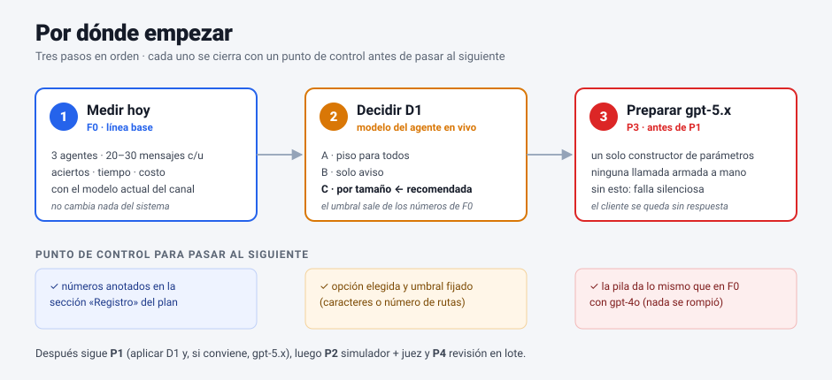
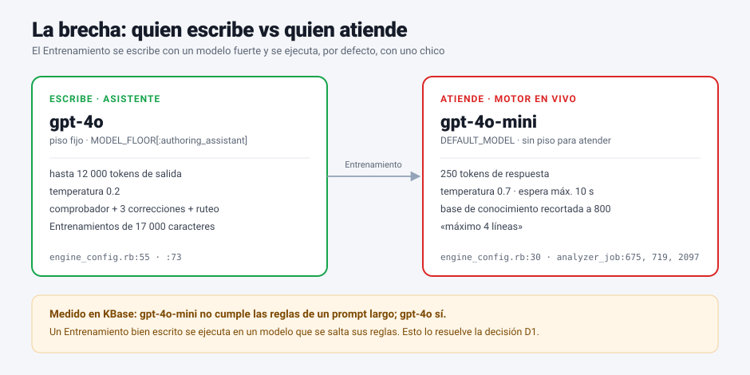
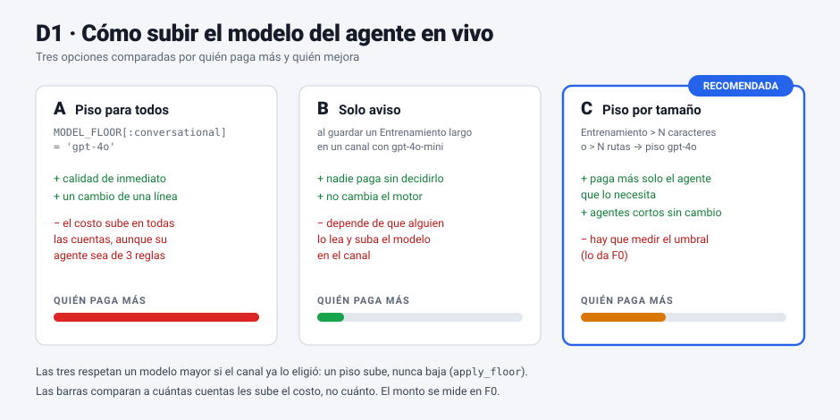
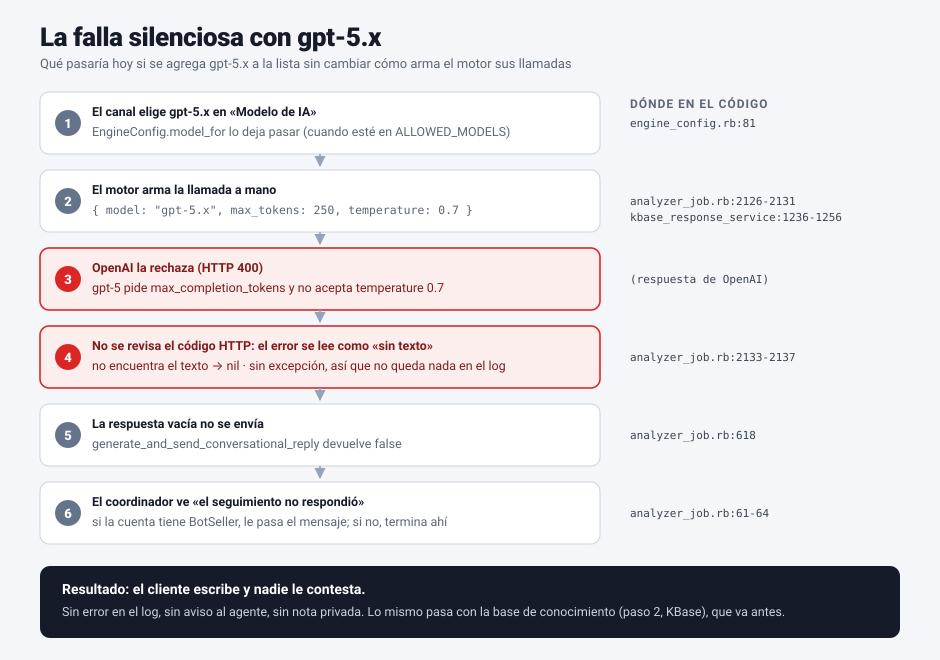
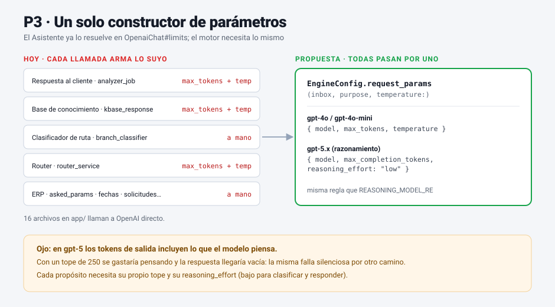
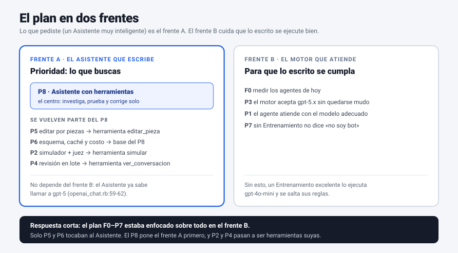
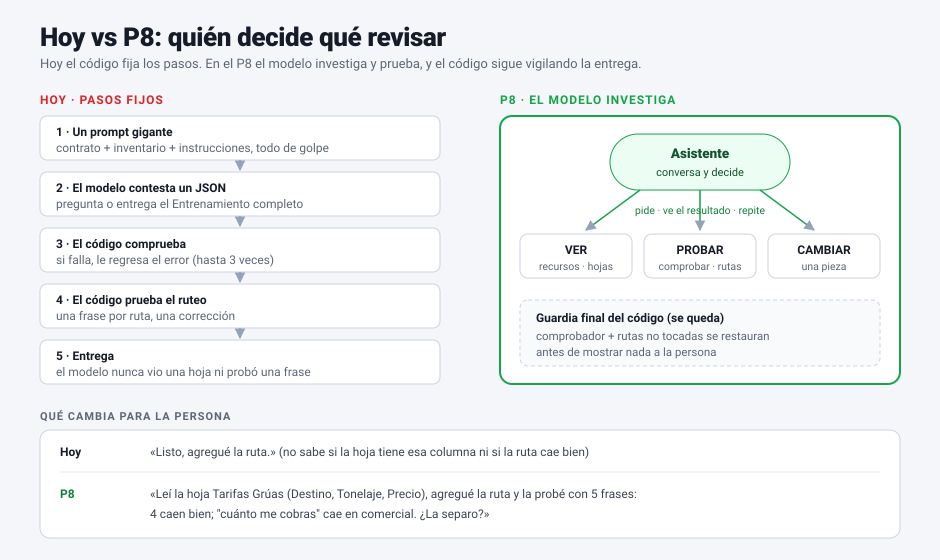
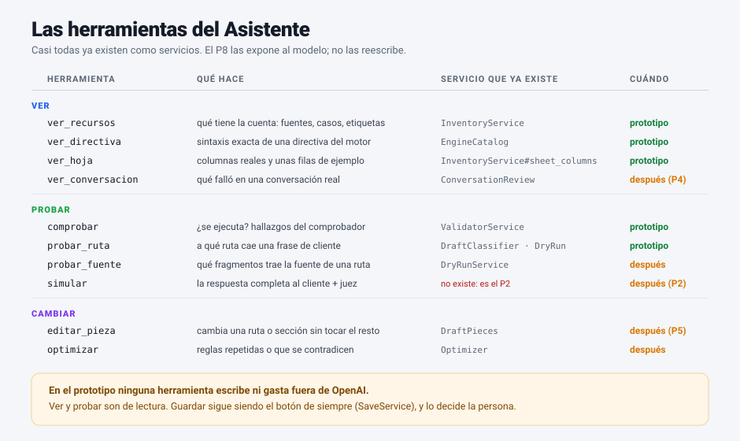
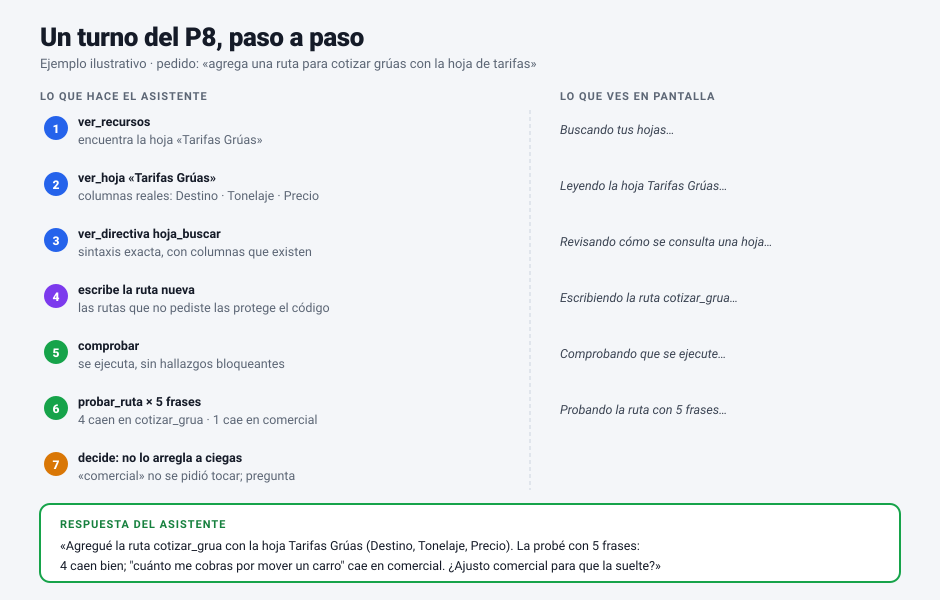
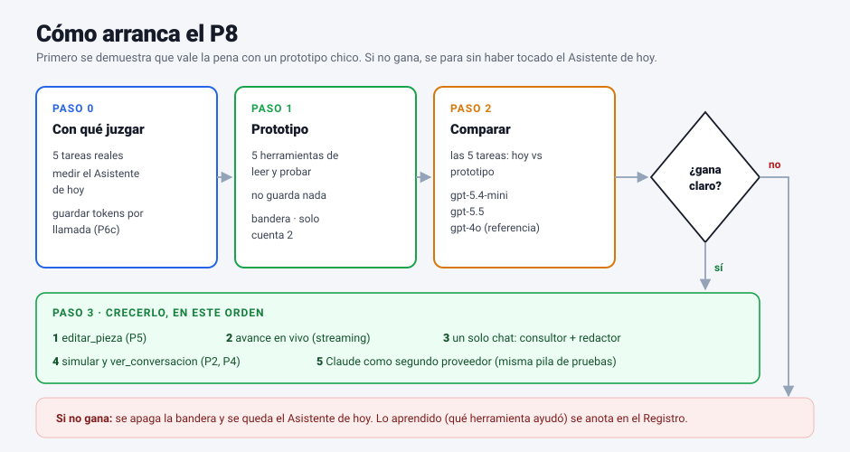

# Diagnóstico del Asistente de Agentes IA — plan de mejoras

> **Rama:** `diag/asistente_agentes_ia` (sale de `develop` en `3e58e050`)
> **Fecha:** 08/10/2026 · actualizado 12/10/2026 (dos frentes y P8)
> **Estado:** SOLO PLAN. No se ha tocado código. Se revisa punto por punto y cada uno se aprueba antes de empezarlo.
> **Prioridad:** el **frente A** (P8, Asistente con herramientas). Ver «0.2 Dos frentes».

---

## 0. La pregunta y la respuesta corta

**¿El Asistente es tan inteligente como una IA de punta para generar los prompts de los agentes?**

Escribe bien. Lo que tiene alrededor del modelo (comprobador, correcciones, prueba de ruteo, optimizador) es mejor que pedirle un prompt a ChatGPT. **El punto débil no está en quién escribe el prompt, sino en lo que pasa después:**

1. El agente en vivo corre en un modelo **más chico** que el que escribió su prompt.
2. **Nadie comprueba lo que el agente contesta**, solo a qué ruta manda cada mensaje.
3. Los modelos nuevos (gpt-5.x) **no se pueden elegir**, ni para escribir ni para atender.

### Cómo está hoy

```
 ┌───────────────────────── ASISTENTE (escribe) ─────────────────────────┐
 │                                                                        │
 │  Persona ──► Chat consultor ───────► Redactor ──────► Entrenamiento    │
 │              gpt-5.4-mini            gpt-4o (piso)        │            │
 │              (DraftingChat)          (InterviewService)   │            │
 │                                          │                │            │
 │                     ┌────────────────────┤                │            │
 │                     ▼                    ▼                │            │
 │              Comprobador sin IA    Prueba de ruteo        │            │
 │              ¿se ejecuta?          ¿cada ruta se elige?   │            │
 │              (3 correcciones)      (1 corrección)         │            │
 └───────────────────────────────────────────────────────────┼────────────┘
                                                             │
                     ⚠ aquí se pierde la calidad             │
                                                             ▼
 ┌───────────────────────── MOTOR EN VIVO (atiende) ──────────────────────┐
 │  Cliente ──► Clasificador ──► Ruta ──► Respuesta al cliente            │
 │              gpt-4o-mini       │       gpt-4o-mini · 250 tokens         │
 │              (por defecto)     │       contexto recortado a 800         │
 │                                │       "máximo 4 líneas"                │
 │                                ▼                                        │
 │                     ✗ nadie califica lo que contestó                    │
 └─────────────────────────────────────────────────────────────────────────┘
```

### A dónde queremos llegar

```
  Asistente escribe ──► Motor ejecuta con el modelo adecuado
          ▲                         │
          │                         ▼
          │              Simulador de conversación (camino REAL)
          │                         │
          │                         ▼
          │              Juez: ¿cumplió las reglas del Entrenamiento?
          │                         │
          └──── propuesta de cambio ◄┘   + revisión en lote de conversaciones reales
```

---

## 0.1 Por dónde empezar

> **Nota (12/10/2026):** estos tres pasos son el arranque del **frente B** (el motor que atiende). El frente A, que es la prioridad, arranca con el **P8 → Paso 0**. Ver «0.2 Dos frentes».

> Se lee en 5 minutos. Explica los **tres primeros pasos** y **por qué van en ese orden**. El detalle de cada punto está más abajo, en su propio apartado.



### Paso 1 · Medir cómo está hoy (F0)

**Qué es:** correr la pila de pruebas de 3 agentes con el modelo que ya tienen y anotar los números. No se cambia nada del sistema.

**Por qué primero:** todo lo que sigue cuesta dinero (un modelo mayor) o tiempo (cambiar el motor). Sin los números de hoy no hay forma de saber si un cambio mejoró algo o solo encareció. Ya pasó con KBase: el cambio de gpt-4o-mini a gpt-4o se decidió porque se midió.

**Cómo, paso a paso:**
1. Elegir los 3 agentes de referencia: ADAM v2.4 (#11833), el v6.11 (17.066 caracteres) y el de variables (#12148).
2. Escribir de 20 a 30 mensajes de cliente por agente, con la ruta a la que **deberían** ir.
3. Correr «Probar el agente» en cada uno y guardar el informe .md.
4. Anotar en la sección «Registro → F0»: aciertos de ruteo, tiempo por respuesta y costo. El costo sale por ahora del panel de uso de OpenAI de la cuenta, porque el sistema todavía no lo guarda (eso es el P6c).
5. Revisar a mano 10 respuestas por agente y marcar cuáles rompen una regla de su Entrenamiento. Este es el número que más interesa, y hoy solo se puede sacar a mano (el P2 lo automatiza).

**Se da por cerrado cuando:** los números están en el Registro.

### Paso 2 · Decidir cómo subir el modelo del agente en vivo (D1)

**Qué es:** elegir entre tres formas de que los agentes con un Entrenamiento grande dejen de correr en gpt-4o-mini.



**El problema, en una frase:** el Asistente escribe el Entrenamiento con gpt-4o y lo revisa tres veces, pero el agente que atiende al cliente lo ejecuta con gpt-4o-mini, que ya medimos que se salta las reglas de un prompt largo.



**Cómo leer las opciones:**
- **A · Piso para todos.** Es una línea de código y la calidad sube al día siguiente, pero a todas las cuentas les sube el costo, aunque su agente tenga 3 reglas.
- **B · Solo aviso.** No cuesta nada, pero depende de que alguien lea el aviso y cambie el modelo del canal.
- **C · Piso por tamaño (recomendada).** Solo sube el modelo de los agentes con un Entrenamiento grande, que son los que gpt-4o-mini no puede seguir. El umbral (caracteres o número de rutas) sale de los números del Paso 1.

**Se da por cerrado cuando:** está elegida la opción y, si es C, fijado el umbral.

> Decidir no es aplicar. La opción elegida se implementa en el P1, **después** del Paso 3.

### Paso 3 · Preparar el motor para gpt-5.x antes de usarlo (P3)

**Qué es:** hacer que todas las llamadas del motor a OpenAI armen sus parámetros en un solo lugar, para que un modelo gpt-5.x funcione en cuanto alguien lo elija.

**Por qué antes de aplicar D1:** porque si D1 termina en «conviene gpt-5.x» y se agrega a la lista tal como está hoy el motor, **el agente deja de contestar sin que nadie se entere**. Así pasaría:



**La falla, paso a paso:**
1. El canal elige gpt-5.x en «Modelo de IA».
2. El motor arma la llamada a mano con `max_tokens: 250` y `temperature: 0.7` (`contact_tracking_response_analyzer_job.rb:2096-2101`).
3. OpenAI la rechaza: los modelos gpt-5 piden `max_completion_tokens` y no aceptan esa temperatura.
4. El motor no revisa el código HTTP. Busca el texto de la respuesta, no lo encuentra y devuelve vacío. Como no hubo excepción, **no se escribe nada en el log** (`:2103-2107`).
5. La respuesta vacía no se envía (`:618`).
6. El coordinador ve que el seguimiento «no respondió». Si la cuenta tiene BotSeller, le pasa el mensaje; si no, termina ahí (`:61-64`).

**Resultado:** el cliente escribe y nadie le contesta. No hay error en el log, ni aviso al agente humano, ni nota privada. Lo mismo pasa antes en la base de conocimiento (`knowledge_base_response_service.rb:1236-1256`), que arma su llamada igual.

**El arreglo:**



1. Crear `EngineConfig.request_params`, que devuelve los parámetros correctos según el modelo. Es la misma regla que el Asistente ya usa en `OpenaiChat#limits`.
2. Pasar las llamadas del motor a ese constructor **una por una, sin cambiar todavía el modelo**. Así cualquier diferencia en la pila es culpa del cambio, no del modelo.
3. Hacer que las llamadas **revisen el código HTTP** y registren el error. Con eso, una falla futura deja rastro aunque no sea de gpt-5.
4. Correr la pila de F0 con gpt-4o: tiene que dar lo mismo que en el Paso 1.
5. Recién entonces agregar gpt-5.x a `ALLOWED_MODELS`, `MODEL_RANK` y al selector del canal (`apps.yml`), con un tope de tokens y un `reasoning_effort` por propósito.

**Se da por cerrado cuando:** ninguna llamada del motor arma sus parámetros a mano, todas registran el error de OpenAI, y la pila con gpt-4o da lo mismo que en F0.

### Después de estos tres pasos

Con los números (Paso 1), la decisión (Paso 2) y el motor listo (Paso 3), el **P1** aplica la opción elegida sin riesgo y se mide contra F0. Siguen el **P2** (simulador + juez) y el **P4** (revisión en lote).

---

## 0.2 Dos frentes: qué busca este plan

> Agregado el 12/10/2026, después de aclarar el objetivo: **un Asistente que escriba prompts tan bien como ChatGPT o Claude cuando les das contexto**, usando los recursos y servicios del sistema, y con un chat que de verdad ayude a crear y mejorar rutas, secciones y contexto.

Con ese objetivo, el plan F0–P7 estaba enfocado sobre todo en **el motor que atiende** y no en **el Asistente que escribe**. Solo P5 y P6 tocaban al Asistente. Por eso el plan se ordena en dos frentes:



| Frente | Qué cuida | Puntos | Prioridad |
|--------|-----------|--------|-----------|
| **A · El Asistente que escribe** | que escriba, pruebe y mejore Entrenamientos como un experto | **P8** (centro) + P5, P6, P2, P4 como piezas suyas | **primero** |
| **B · El motor que atiende** | que lo escrito se cumpla con el cliente | F0, P3, P1, P7 | en paralelo, sin bloquear al A |

**El frente A no depende del B.** El Asistente ya sabe llamar a modelos gpt-5 (`assistant/openai_chat.rb:59-62`) y su chat consultor ya corre en gpt-5.4-mini. Lo que el P3 arregla es el motor que atiende clientes, no el Asistente.

---

## 1. Mapa de puntos

| # | Frente | Punto | Impacto | Esfuerzo | Depende de |
|---|--------|-------|---------|----------|------------|
| **P8** | **A** | **Asistente con herramientas** | **muy alto** | alto (prototipo: medio) | P6c para medir costo |
| P5 | A | Cada edición reescribe todo el Entrenamiento | medio | medio-alto | — (se vuelve `editar_pieza` del P8) |
| P6 | A | Ajustes técnicos: esquema JSON, caché y costo | bajo-medio | bajo | — (base del P8) |
| P2 | A · B | Las pruebas no califican respuestas | **muy alto** | alto | P3 (deseable); se vuelve `simular` del P8 |
| P4 | A · B | Revisar conversaciones reales en lote | medio-alto | medio | P2 (el juez); se vuelve `ver_conversacion` del P8 |
| F0 | B | Línea base: medir antes de cambiar | — | bajo | — |
| P3 | B | Los modelos gpt-5.x no se pueden elegir (motor) | alto | medio | — |
| P1 | B | El agente en vivo corre en un modelo menor | **alto** | bajo-medio | F0 · D1 · P3 |
| P7 | B | Sin Entrenamiento, el agente dice no ser bot (casi resuelto) | bajo | bajo | D7 |

### Orden propuesto

```
  FRENTE A (prioridad)
  P6c ──► P8 Paso 0 ──► P8 prototipo ──► comparar ──► P8 crece: P5 · streaming · un chat · P2 · P4 · Claude
  (medir   (5 tareas)   (5 herramientas)  (¿gana?)
   tokens)

  FRENTE B (en paralelo)
  F0 ──► P3 ──► P1          P7 cuando haya hueco
```

P3 va antes que P1 porque P1 quiere elegir entre gpt-4o y gpt-5.x, y hoy gpt-5.x no se puede elegir. Agregarlo a la lista sin preparar el motor haría que el agente deje de contestar sin dejar rastro: ver «0.1 Por dónde empezar → Paso 3».

---

## F0 · Línea base: medir antes de cambiar

**Por qué:** sin números de hoy no podremos decir si un cambio mejoró algo. Ya pasó en KBase: el cambio de gpt-4o-mini a gpt-4o se decidió midiendo.

**Qué se mide:**

| Métrica | Cómo | Dónde existe ya |
|---------|------|-----------------|
| Aciertos de ruteo | pila de pruebas del agente | `TestBattery`, `SuggestedTests` |
| Respuestas que rompen una regla | revisión manual de N conversaciones | `ConversationReview` (una por una) |
| Correcciones por turno del redactor | `repairs` del resultado | `InterviewService#repair_grammar` |
| Tiempo por turno al editar | ya medido: 40–52 s por llamada | nota en `interview_service.rb:54` |
| Costo por turno | tokens de entrada/salida de OpenAI | **no se guarda hoy** |

**Agentes de prueba:** ADAM v2.4 (#11833), el v6.11 (17.066 caracteres) y el agente de variables (#12148).

**Pasos:**
- [ ] Elegir 3 agentes de referencia y 20–30 mensajes de cliente por agente
- [ ] Correr la pila de cada agente con el modelo actual del canal
- [ ] Anotar aciertos, tiempos y costo en la sección «Registro» de este documento
- [ ] Decidir qué número tiene que mejorar cada punto para darlo por bueno

---

## P1 · El agente en vivo corre en un modelo menor que el que lo escribió

### Problema
El Asistente escribe con **gpt-4o** (piso fijo), pero el agente que atiende clientes usa lo que diga el canal, y **por defecto es gpt-4o-mini**. Ya está medido en KBase que gpt-4o-mini **no cumple las reglas de un prompt largo**. Un Entrenamiento bien escrito se ejecuta en un modelo que se salta sus reglas.

Además, la respuesta al cliente sale con límites muy cortos.

### Evidencia
| Qué | Dónde |
|-----|-------|
| `DEFAULT_MODEL = 'gpt-4o-mini'` | `app/services/contact_trackings/engine_config.rb:30` |
| Piso de modelo solo para el Asistente y solicitudes, **no** para atender | `engine_config.rb:73` |
| Respuesta conversacional: 250 tokens, temperatura 0.7 | `engine_config.rb:42` · `contact_tracking_response_analyzer_job.rb:2097-2100` |
| Base de conocimiento recortada a 800 caracteres | `contact_tracking_response_analyzer_job.rb:675` |
| «Máximo 4 líneas» | `contact_tracking_response_analyzer_job.rb:719-721` |
| Tiempo de espera de 10 s en esa llamada | `contact_tracking_response_analyzer_job.rb:2090` |

### Propuesta (opciones a decidir)

```
  Opción A — Piso por propósito          Opción B — Aviso, sin forzar
  ───────────────────────────────        ──────────────────────────────
  MODEL_FLOOR[:conversational]           Al guardar un Entrenamiento largo
    = 'gpt-4o'                           en un canal con gpt-4o-mini,
  Todos los agentes suben de golpe.      el Asistente avisa: "este agente
  + calidad inmediata                    no va a seguir sus reglas en
  − costo sube en todas las cuentas      gpt-4o-mini; súbelo en el canal".
                                         + nadie paga sin decidir
                                         − depende de que lo lean

  Opción C — Piso por tamaño del Entrenamiento (recomendada)
  ───────────────────────────────────────────────────────────
  Si el Entrenamiento pasa de N caracteres o de N rutas → piso gpt-4o.
  Si es corto → se respeta lo que diga el canal.
  + paga más solo quien tiene un agente que lo necesita
```

Los límites (250 tokens, 800 caracteres y 4 líneas) se revisan **aparte** y solo con la medición de F0: subirlos alarga las respuestas en WhatsApp, y eso también es una decisión de producto.

### Pasos
- [ ] Decidir A, B o C (decisión **D1**)
- [ ] Si es C: fijar el umbral con los agentes de F0
- [ ] Implementar en `EngineConfig` (un solo lugar, como pide su propia cabecera)
- [ ] Revisar si el tope de 10 s alcanza con gpt-4o (y con gpt-5.x, ver P3)
- [ ] Medir los límites 250 / 800 / 4 líneas por separado (decisión **D2**)
- [ ] Repetir la pila de F0 y comparar

### Riesgos
- **Costo.** gpt-4o cuesta varias veces lo que gpt-4o-mini. Hay que medirlo con tráfico real antes de subirlo para todos.
- Respuestas más lentas en el canal.

---

## P2 · Las pruebas no califican lo que contesta el agente

### Problema
Todo lo que existe para probar revisa **a qué ruta va** un mensaje y **qué fragmentos trae** la fuente. Nada revisa **qué le contestaría el agente al cliente**. Un agente puede rutear perfecto y aun así:
- inventar un precio,
- prometer algo que su Entrenamiento prohíbe,
- tratar de usted cuando debía tutear,
- no pedir el dato que la ruta exige.

Fue una decisión **deliberada** (`dry_run_service.rb:20-33`): la respuesta la arma `KnowledgeBaseResponseService#generate_contextual_reply`, atado a una conversación real, y armar una «respuesta parecida» por otro camino sería mentir. **La decisión era correcta; lo que falta es poder correr el camino real sin una conversación real.**

### Evidencia
| Qué | Dónde |
|-----|-------|
| La prueba en seco no redacta la respuesta | `app/services/contact_trackings/assistant/dry_run_service.rb:20` |
| Los tests sugeridos solo pasan por el clasificador | `suggested_tests.rb` |
| La pila de pruebas arranca con botón (costo) | `test_battery.rb` (decisión D4 del plan de importar) |

### Propuesta

```
  1. Conversación simulada           2. Camino REAL                 3. Juez
  ──────────────────────────         ─────────────────────          ─────────────────────
  Objeto en memoria con la          generate_contextual_reply       Modelo fuerte (gpt-4o
  misma forma que Conversation:     recibe la simulación en vez     o gpt-5.x) recibe:
  mensajes, contacto, canal,        de la conversación real.        · el Entrenamiento
  variables.                        ✗ no crea Message                · la pregunta
  Sin escribir en la base.          ✗ no envía nada                  · la respuesta
                                    ✗ no abre casos                  · los fragmentos
                                                                    y devuelve, regla por
                                                                    regla: cumple / rompe
                                                                    / no aplica, con cita.
```

- El juez **no corrige**, solo señala. La corrección la sigue haciendo el chat del Asistente si la persona la pide, igual que hoy con `ConversationReview`.
- Escenarios de **varios turnos**, no solo un mensaje suelto (pedir un dato, que el cliente no lo dé, que lo dé después).
- Las fuentes externas en vivo (Discourse, Contpaq, ERP, hoja en modo Datos) se siguen marcando como «no se corre en seco», o se les da una respuesta grabada.

### Pasos
- [ ] Leer `generate_contextual_reply` completo y listar todo lo que toma de la conversación real
- [ ] Diseñar la conversación simulada (decisión **D3**: objeto en memoria o transacción con rollback)
- [ ] Hacer que el camino real acepte la simulación **sin cambiar** lo que hace con una conversación real
- [ ] Escribir el juez con salida en esquema estricto (ver P6)
- [ ] Agregar el informe del juez al informe .md de la pila de pruebas
- [ ] Probar con ADAM y el v6.11: ¿encuentra lo que ya sabemos que está mal?

### Riesgos
- **El más alto:** que la simulación se salga y escriba en una conversación real. Recordar que el entorno de pruebas corre contra `chatwoot_dev` y ya borró conversaciones reales.
- Costo: cada escenario es una respuesta más una calificación. Se queda con botón, nunca automático.
- Un juez con un modelo chico opina en vez de verificar. Se usa el modelo fuerte.

---

## P3 · Los modelos gpt-5.x no se pueden elegir

### Problema
La lista de modelos permitidos solo conoce gpt-4 y gpt-3.5. Aunque alguien quiera usar gpt-5.x para atender o para escribir, **no puede**. Y no basta con agregarlo a la lista: el motor en vivo arma sus llamadas a mano con `max_tokens` y `temperature`, **parámetros que los modelos gpt-5 no aceptan**. El Asistente ya resuelve esto (`OpenaiChat#limits`); el motor no.

### Evidencia
| Qué | Dónde |
|-----|-------|
| `ALLOWED_MODELS = %w[gpt-4o-mini gpt-4o gpt-4-turbo gpt-3.5-turbo]` | `engine_config.rb:35` |
| `MODEL_RANK` solo ordena esos cuatro | `engine_config.rb:75` |
| El selector del canal tiene el mismo enum | `config/integration/apps.yml:31` |
| El Asistente ya distingue modelos de razonamiento | `assistant/openai_chat.rb:24` (`REASONING_MODEL_RE`) y `:59-62` |
| El motor manda `max_tokens` + `temperature` a mano | `knowledge_base_response_service.rb:1236-1256` · `contact_tracking_response_analyzer_job.rb:2096-2101` · `branch_classifier_service.rb:74` · `router_service.rb:209` · `external_db/asked_params.rb:85` |
| Archivos que llaman a OpenAI directo | 16 en `app/` |
| El chat consultor ya midió gpt-5.x | `drafting_chat.rb:26-29` (gpt-5.5: nivel ChatGPT, pero 55 s) |

### Propuesta

```
                    ┌──────────────────────────────┐
  cada llamada ───► │ EngineConfig.request_params  │ ──► { model, max_tokens, temperature }
  del motor         │ (model, purpose, temp)       │       o
                    └──────────────────────────────┘     { model, max_completion_tokens,
                                                           reasoning_effort }
```

- Un solo constructor de parámetros, igual al que ya tiene `OpenaiChat`, para que ninguna llamada vuelva a armarlos a mano.
- Agregar gpt-5.x a `ALLOWED_MODELS`, `MODEL_RANK` y `apps.yml` (el spec `engine_config_spec.rb` ya verifica que coincidan).
- **Ojo con el razonamiento:** en gpt-5 los tokens de salida incluyen lo que el modelo piensa. Un tope de 250 se gastaría pensando y la respuesta llegaría vacía. Cada propósito necesita su tope y su `reasoning_effort` (bajo para clasificar y responder).
- Revisar los tiempos de espera: 10 s en la respuesta al cliente puede no alcanzar.

### Pasos
- [ ] Listar las 16 llamadas y cuáles son del motor de seguimientos
- [ ] Crear el constructor de parámetros en `EngineConfig`
- [ ] Pasar las llamadas del motor a ese constructor, una por una, sin cambiar el modelo todavía
- [ ] Que cada llamada revise el código HTTP y registre el error de OpenAI (hoy un rechazo se lee como «sin texto» y no deja log: `contact_tracking_response_analyzer_job.rb:2103-2107`)
- [ ] Correr la pila de F0 con gpt-4o: tiene que dar lo mismo
- [ ] Agregar gpt-5.x a la lista, al orden y al selector del canal
- [ ] Decidir qué modelo usa el redactor del Asistente (decisión **D4**)
- [ ] Medir con F0: aciertos, tiempo y costo de gpt-4o contra gpt-5.x

### Riesgos
- Una llamada que se quede con `max_tokens` falla **en silencio** con gpt-5 (el motor devuelve nil y el cliente no recibe nada).
- Latencia: gpt-5.5 tardó 55 s en el chat consultor. Para atender clientes sirve un modelo rápido, no el más grande.

---

## P4 · Revisar conversaciones reales en lote

### Problema
`ConversationReview` funciona bien (separa si la causa es el Entrenamiento, la configuración o el motor), pero **una conversación a la vez**, pegando el link en el chat. Nadie revisa sistemáticamente cómo le va a un agente con clientes reales.

### Evidencia
| Qué | Dónde |
|-----|-------|
| Revisión de una conversación | `assistant/conversation_review.rb` |
| Copia vieja del Entrenamiento en seguimientos | ya detectado: los seguimientos usan una copia vieja |

### Propuesta

```
  Botón «Revisar las últimas N conversaciones» del agente
     │
     ├─► ConversationReview por cada una (lo que ya existe)
     │
     ├─► Agrupar hallazgos: misma regla rota en 7 de 20 → un solo hallazgo
     │
     └─► Informe: lo que más se repite primero, con links a la evidencia,
         y una propuesta de cambio que el chat del Asistente aplica si se pide
```

### Pasos
- [ ] Decidir cuántas conversaciones y cuáles: últimas N, solo las que pasaron a humano, solo las de una etiqueta (decisión **D5**)
- [ ] Correrlo como job con avance (como la pila de pruebas), nunca en la petición
- [ ] Agrupar hallazgos repetidos
- [ ] Reusar el juez de P2 para que las dos herramientas califiquen igual

### Riesgos
- Costo: N revisiones con gpt-4o. Con botón y tope de N.
- Privacidad: el informe trae texto de clientes. Se queda dentro de la cuenta.

---

## P5 · Cada edición reescribe todo el Entrenamiento

### Problema
Para cambiar una regla, el modelo devuelve el Entrenamiento **completo**. En el v6.11 eso son 17.066 caracteres y más de 4.000 tokens de salida por llamada, con **40–52 s** por llamada. El turno tiene un tope de **200 s**: con tres correcciones más la del ruteo, se queda sin tiempo. Ya hay una red (`repair_edit` detecta lo destructivo que no se pidió), pero reescribir todo es la causa de que haga falta.

### Evidencia
| Qué | Dónde |
|-----|-------|
| Se pide el Entrenamiento completo | `assistant/interview_service.rb:25-34` |
| 40–52 s por llamada, proxy corta a 300 s | `interview_service.rb:54-59` |
| Tope de salida subido a 12.000 por esto | `engine_config.rb:49-55` |

### Propuesta

```
  Hoy                                    Propuesta
  ───────────────────────────────        ──────────────────────────────────
  Modelo devuelve 17.000 caracteres      Modelo devuelve solo las piezas tocadas:
  → se compara contra lo que había       [{ "pieza": "@ruta(soporte)",
  → si borró algo, se le regresa           "nuevo": "…texto…" }]
                                         → DraftPieces las reemplaza
                                         → el resto NO puede cambiar
```

- Ya existe `DraftPieces` (lo usa el optimizador para restaurar piezas), así que la base está.
- Al **crear** se sigue pidiendo completo. Esto es solo para **editar**.

### Pasos
- [ ] Confirmar que `DraftPieces` sabe partir y reemplazar cualquier pieza (secciones y rutas)
- [ ] Contrato nuevo de salida para editar: lista de piezas
- [ ] Mantener el contrato viejo como respaldo si el modelo devuelve completo
- [ ] Medir tiempo y costo contra F0 con el v6.11

### Riesgos
- Cambios que cruzan piezas (renombrar una etiqueta usada en 5 rutas) necesitan que el modelo devuelva las 5. El comprobador lo detecta.

---

## P6 · Ajustes técnicos: esquema JSON y caché

### 6a · Esquema estricto en vez de JSON libre
**Hoy:** `response_format: { type: 'json_object' }` (`assistant/openai_chat.rb:49`). OpenAI garantiza que la respuesta sea JSON, pero **no qué llaves trae**. Por eso existen `EmptyPromise` (ni preguntó ni entregó) y la vuelta extra cuando falta `modo`.
**Propuesta:** `json_schema` con `strict: true` para `mensaje`, `entrenamiento`, `modo`, `toca` y `cambios`.
- [ ] Definir el esquema del redactor, del chat consultor y del juez (P2)
- [ ] Medir si bajan las vueltas extra

### 6b · Caché de prompts
**Hoy:** el prompt del redactor se arma como *contrato fijo → inventario de la cuenta → instrucciones fijas → …* (`interview_service.rb:350-358`). OpenAI cachea **el principio común** del prompt, así que el inventario en medio corta la parte fija.
**Propuesta:** todo lo fijo primero y lo de la cuenta después.
- [ ] Reordenar y comprobar que el modelo se comporte igual (pila de F0)
- [ ] Guardar los tokens cacheados que devuelve OpenAI para ver el ahorro

### 6c · Registrar costo
Hoy no se guarda cuántos tokens gasta cada turno. Sin eso, F0 y P1 se deciden a ciegas.
- [ ] Guardar los tokens de entrada, salida y caché por llamada del Asistente

---

## P7 · El agente sin Entrenamiento dice no ser bot

### Estado: casi resuelto

El caso grave **ya está corregido**. Con ADAM, la respuesta que se daba cuando la fuente no resolvía fingía ser una persona y tuteaba. Se arregló en el commit `5784ce86` (importar extenso F5–F7, entró a develop con el PR #65, decisión D5 del 29/09/2026). Hoy, **si el agente tiene Entrenamiento**, manda el Entrenamiento: su trato, su tono, y si le preguntan si es persona, no lo afirma (`contact_tracking_response_analyzer_job.rb:706-715`).

### Lo que queda
**Sin Entrenamiento**, la instrucción sigue diciendo:

> «Responde como un humano amable y conocedor del tema. NUNCA menciones que eres un bot o sistema automático.» (`:708-709`)

Solo afecta a los seguimientos que no tienen Entrenamiento cargado.

- [ ] Decidir si un seguimiento sin Entrenamiento puede negar que es bot (decisión **D7**)
- [ ] Si no: cambiar la frase por la misma regla del caso con Entrenamiento («si te preguntan si eres una persona, no lo afirmes»)
- [ ] Borrar `conversational_fallback` (`:726`): no lo llama nadie en `app/`, `lib/` ni `spec/`. Es código muerto que todavía dice «un asesor te contactará».

---

## P8 · Asistente con herramientas

### El objetivo
Un Asistente que, igual que ChatGPT o Claude con contexto, **investigue antes de contestar, pruebe lo que escribe y corrija con evidencia**, usando lo que la cuenta tiene de verdad: hojas, tipos de caso, etiquetas, calendario y las directivas del motor.

### Por qué hoy no se siente así
El Asistente **ya sabe mucho**:
- las fuentes, las columnas reales de las hojas, los tipos de caso, las etiquetas y las frases de clientes (`InventoryService`);
- la sintaxis de cada directiva (`EngineCatalog`);
- si un Entrenamiento se ejecuta (`ValidatorService`) y si cada ruta se elige a sí misma (`RouteSelfCheck`).

Pero el modelo **no puede usar nada de eso por su cuenta**. Recibe todo de golpe en un solo prompt, contesta un JSON, y el **código** decide qué revisar y en qué orden:



| | Hoy | Con el P8 |
|---|---|---|
| Quién decide qué revisar | el código, siempre los mismos pasos | el modelo, según lo que haga falta |
| Hojas | ve una lista de columnas dentro de un prompt enorme | **lee** la hoja que necesita cuando la necesita |
| Rutas | se prueba una frase por ruta, una corrección | **prueba las frases que quiera** y ve dónde caen |
| Lo que te dice | «Listo, agregué la ruta» | qué leyó, qué probó, qué salió bien y qué no |
| Chats | dos separados: consultor (`DraftingChat`, gpt-5.4-mini, en la petición) y redactor (`InterviewService`, gpt-4o, en segundo plano) | uno solo de principio a fin (Paso 3) |
| Seguridad | comprobador al final | **igual**: la guardia del código se queda |

### Las herramientas
Casi todas ya existen como servicios. El P8 las pone al alcance del modelo (en OpenAI se llama *function calling*; en Claude, *tool use*), no las reescribe.



### Cómo se vería un turno
Ejemplo ilustrativo: la hoja y las columnas son inventadas para mostrar el flujo.



Cada herramienta avisa su paso real en pantalla con el mismo mecanismo que ya existe (`TurnProgress` en Redis, consultado por la pantalla mientras espera). El turno corre en segundo plano como hoy (`InterviewJob`), así que varias llamadas seguidas no chocan con el tiempo de espera del proxy.

### Lo que NO cambia
- **La guardia final del código.** Haga lo que haga el modelo, antes de mostrar nada se corre el comprobador, y las rutas que la persona no pidió tocar se restauran (`DraftPieces.restore`, como ya hace el optimizador).
- **Guardar lo decide la persona**, con el botón de siempre (`SaveService`).
- **El Asistente de hoy sigue funcionando.** El P8 vive detrás de una bandera hasta demostrar que es mejor.

### Cómo arranca



#### Paso 0 · Con qué lo vamos a juzgar
Cinco tareas reales, las mismas para el Asistente de hoy y para el prototipo:

| # | Tarea | Qué demuestra |
|---|-------|---------------|
| T1 | Crear un agente desde cero conversando (ej. un consultorio que agenda) | el chat ayuda de verdad |
| T2 | Agregar una ruta que use una hoja de la cuenta | usa los recursos reales |
| T3 | Arreglar una ruta que se come mensajes de otra | mejora rutas con evidencia |
| T4 | Mejorar una sección (contexto o estilo) sin romper lo demás | mejora secciones sin daños |
| T5 | Revisar una conversación real y proponer qué cambiar | aprende de lo que pasó |

Por cada tarea se mide:
- ¿se ejecuta?
- ¿rutea bien?
- ¿cuántas vueltas hicieron falta?
- tiempo y costo;
- **tu calificación** de qué tan útil fue el chat (1 a 5).

- [x] Acordar las 5 tareas (decisión **D9**)
- [x] Guardar los tokens de cada llamada del Asistente (es el P6c; sin esto no se puede comparar costo)
- [x] Correr las 5 tareas con el Asistente de hoy y anotar los números en el Registro (12/10/2026; falta la nota de la T5)

#### Paso 1 · Prototipo
- [ ] Servicio nuevo que conversa y usa herramientas: el modelo pide una herramienta, el código la corre, el modelo ve el resultado y sigue, hasta contestar.
- [ ] Las 5 herramientas del prototipo, todas de **solo leer y probar**: `ver_recursos`, `ver_directiva`, `ver_hoja`, `comprobar`, `probar_ruta`.
- [ ] Topes: máximo de llamadas a herramientas por turno, y el mismo presupuesto de tiempo del turno de hoy (`TURN_BUDGET_SECONDS = 200`).
- [ ] Cada herramienta devuelve un resumen corto (ej. columnas + 3 filas, no la hoja entera) para no llenar el contexto.
- [ ] Cada herramienta avisa su paso en `TurnProgress`.
- [ ] Detrás de una bandera, **solo la cuenta 2** (decisión **D11**). La pantalla no cambia: un interruptor «modo nuevo» solo para la prueba.

#### Paso 2 · Comparar
- [ ] Las 5 tareas con el prototipo, con 2 o 3 modelos (decisión **D8**)
- [ ] Tabla en el Registro: hoy contra prototipo, por modelo
- [ ] Decidir: si gana claro, sigue el Paso 3; si no, se apaga la bandera y se anota qué herramienta sí ayudó

#### Paso 3 · Crecerlo (solo si ganó)
1. **`editar_pieza`** (el P5): cambiar una ruta o sección sin reescribir el Entrenamiento.
2. **Avance en vivo (streaming)**: la respuesta aparece mientras se escribe.
3. **Un solo chat**: unir el consultor y el redactor, con un solo modelo y todo el contexto.
4. **`simular` y `ver_conversacion`** (P2 y P4): probar la respuesta completa al cliente y aprender de conversaciones reales.
5. **Claude como segundo proveedor** (decisión **D12**): misma pila de pruebas, y se queda el que gane por calidad, costo y tiempo.

### Riesgos y cómo se controlan

Cinco riesgos, y tres de los arreglos se apoyan en algo que ya existe en el código. El turno con todas las protecciones:

```
  Turno del Asistente (InterviewJob, segundo plano)
  ┌───────────────────────────────────────────────────────────────────┐
  │  ① presupuesto: máx. N herramientas · 200 s · tope de tokens      │
  │                                                                   │
  │  modelo ──pide──► herramienta ──resumen corto──► modelo  (repite) │
  │     │              ▲  ② la misma consulta 2 veces → «ya la viste»  │
  │     │              │  ③ datos de clientes enmascarados             │
  │     │                                                             │
  │     └─ al llegar al tope ─► ④ se le prohíben herramientas:        │
  │                               tiene que contestar con lo que tiene │
  │                                                                   │
  │  ⑤ guardia del código: comprobar + probar rutas tocadas            │
  │     + restaurar lo no pedido  (corre SIEMPRE, el modelo no decide) │
  └───────────────────────────────────────────────────────────────────┘
```

#### 1 · Costo por turno más alto
**Problema:** el modelo llama varias veces por turno y cada llamada reenvía el contexto.
- **Medir antes de opinar:** guardar los tokens de cada llamada (P6c). OpenAI los devuelve en cada respuesta.
- **Caché de OpenAI:** cuando varias llamadas comparten el mismo inicio del prompt, esa parte se cobra menos. En un turno con herramientas el inicio (instrucciones, catálogo, definición de herramientas) se repite en cada vuelta, y ahí está el ahorro. Hay que poner primero lo fijo y al final lo que cambia (P6b).
- **Respuestas cortas de las herramientas:** `ver_hoja` devuelve columnas y 3 filas, no la hoja entera.
- **Topes:** de llamadas y tokens por turno, y de gasto para la comparación del Paso 2 (**D10**).

#### 2 · Que el modelo se quede dando vueltas
- **Tope de herramientas por turno** (ej. 8), más el presupuesto de 200 s que ya existe (`TURN_BUDGET_SECONDS`).
- **Al llegar al tope se le quitan las herramientas:** la última llamada va con `tool_choice: "none"` y el modelo tiene que contestar con lo que ya tiene.
- **Consultas repetidas:** la misma herramienta con los mismos datos no se vuelve a correr; se le devuelve «ya lo consultaste» con el resultado anterior.
- **Registro de cada turno:** qué herramientas usó y en qué orden, para ver en el Paso 2 si da vueltas de más.

#### 3 · Que pruebe de menos
**El arreglo es que no dependa del modelo.** La guardia final del código corre siempre:
- **comprobar** (`ValidatorService`): si no se ejecuta, se le regresa el error, como hoy;
- **probar las rutas que tocó** (`RouteSelfCheck`), aunque el modelo no lo haya hecho;
- **restaurar lo que no se pidió cambiar** (`DraftPieces.restore`, ya existe).

Además, el modelo tiene que **decir qué probó**, en un formato fijo (esquema estricto, P6a). Si dice que probó algo que no está en el registro del turno, se nota.

#### 4 · Latencia
- **Elegir el modelo midiendo** (**D8**): gpt-5.4-mini tardó 10 s contra 55 s de gpt-5.5 en el chat consultor.
- **Pensar menos donde no hace falta:** bajar el razonamiento de gpt-5 (`reasoning_effort`) para leer y probar, y dejarlo más alto solo para escribir.
- **Avisar cada paso real en pantalla** («Leyendo la hoja Tarifas…») con `TurnProgress`, que ya existe. El streaming llega en el Paso 3.
- **Probar frases al mismo tiempo**, con una condición. Hoy las pruebas de ruteo corren una por una **a propósito** (`assistant/draft_classifier.rb:11-14`): si el clasificador falla, no avisa y devuelve la ruta por defecto, así que en paralelo una falla de conexión se confundiría con «cayó en la ruta equivocada». Es la misma raíz que la falla silenciosa del P3. Para paralelizar, primero el clasificador tiene que distinguir «falló» de «cayó aquí».

#### 5 · Privacidad (cuando llegue `ver_conversacion`)
- **Ya existe un enmascarado** (`assistant/phrase_masker.rb`) que tapa teléfonos (10 dígitos) y números largos (7 dígitos o más) antes de mandar frases de clientes a OpenAI. `ver_conversacion` pasaría por ahí.
- **Lo que no tapa, a propósito:** nombres de persona y números cortos, porque no se distinguen bien de nombres de producto o folios. Para conversaciones completas hay que decidir si se tapa más, por ejemplo correos (**D13**).
- **Solo la cuenta propia y con permiso:** solo conversaciones de la misma cuenta, pasando por la autorización que ya tiene el controlador del Asistente.
- **Solo lo necesario:** los últimos N mensajes, no el historial completo.
- **No guardar texto de clientes** en el registro del turno; solo qué herramienta se usó.

| Riesgo | Arreglo principal | ¿Ya existe algo? |
|---|---|---|
| Costo | medir tokens + caché + topes | no: es el P6 |
| Vueltas | tope + `tool_choice: none` + consultas repetidas | el presupuesto de 200 s |
| Probar de menos | la guardia del código corre siempre | **sí**: comprobador, RouteSelfCheck, restore |
| Latencia | modelo medido + razonamiento bajo + avance en pantalla | **sí**: TurnProgress |
| Privacidad | enmascarar + misma cuenta + últimos N mensajes | **sí**: PhraseMasker |

### Decisiones del P8

| # | Decisión | Opciones | Recomendación |
|---|----------|----------|---------------|
| D8 | Modelo del prototipo | gpt-5.4-mini · gpt-5.5 · gpt-4o | comparar **gpt-5.4-mini** (velocidad) y **gpt-5.5** (techo); gpt-4o como referencia |
| D9 | Las 5 tareas de prueba | las de la tabla · cambiar alguna | las de la tabla, con un agente real de la cuenta 2 en T2–T5 |
| D10 | Tope de gasto en OpenAI para el Paso 2 | monto fijo · sin tope | monto fijo, acordado antes de correr |
| D11 | Quién ve el prototipo | solo cuenta 2 · cuentas elegidas | **solo cuenta 2** |
| D12 | Cuándo y cómo entra Claude | en el prototipo · en el Paso 3 | **Paso 3**: primero demostrar el diseño; luego comparar proveedores. Requiere una clave de Anthropic, porque hoy la clave sale de la integración OpenAI de cada cuenta |
| D13 | ¿Qué se tapa al leer conversaciones completas? | lo que tapa hoy PhraseMasker · también correos y nombres | decidir al llegar a `ver_conversacion` (Paso 3) |

**Decidido el 12/10/2026:** D8 = gpt-5.4-mini + gpt-5.5, con gpt-4o de referencia · D9 = las 5 tareas de la tabla · D10 = medir primero: P6c y UNA tarea con el Asistente de hoy; con ese costo real se propone el tope antes de correr las demás → tope de 3 USD para T2–T5 (la T1 costó < 0,10 USD).

---

## 2. Decisiones abiertas

| # | Decisión | Opciones | Recomendación |
|---|----------|----------|---------------|
| D1 | Cómo subir el modelo del agente en vivo | A piso para todos · B solo aviso · C piso por tamaño | **C**, con umbral medido en F0 |
| D2 | ¿Se tocan los límites 250 tokens / 800 caracteres / 4 líneas? | sí · no · por agente | medir primero, decidir después |
| D3 | Conversación simulada | objeto en memoria · transacción con rollback | **en memoria**: no hay escritura que revertir |
| D4 | Modelo del redactor del Asistente | gpt-4o (hoy) · gpt-5.4-mini · gpt-5.5 | se decide con **D8** (comparación del P8) |
| D5 | Qué conversaciones revisa el lote | últimas N · las que pasaron a humano · por etiqueta | las que pasaron a humano: ahí falló algo |
| D6 | ¿El juez y la pila corren solos alguna vez? | solo con botón · programado | **solo con botón** (costo) |
| D7 | ¿Un seguimiento sin Entrenamiento puede negar que es bot? | sí (como hoy) · no | **no**: misma regla que con Entrenamiento («si te preguntan si eres persona, no lo afirmes») |
| D8–D13 | Decisiones del P8 (modelo, tareas, gasto, alcance, Claude, privacidad) | — | ver «P8 → Decisiones del P8» |

---

## 3. Registro por fase

> Al cerrar cada pieza se anota aquí: qué se hizo, cómo funciona, la pila de pruebas y cómo pedírselo al Asistente.

### P8 · Asistente con herramientas
- **Paso 0, línea base (5 tareas con el Asistente de hoy):**
  - Punto de retorno: tag `estable-2026-10-12-antes-p8` (código; la base de datos no la cubre).
  - Medir tokens: hecho (P6c, ver «P6 · Esquema, caché y costo»). Desde aquí cada respuesta del Asistente guarda lo que gastó.
  - **T1 · crear desde cero conversando (12/10/2026, cuenta 2, sesión #3895, encargo #1131).** Consultorio de psicología «Clara», por el camino completo de la pantalla: chat consultor → «Crear el Entrenamiento» → «Me falta saber» → redacción de una sola vez → cobertura.

    | Tramo | Tiempo | Llamadas | Costo |
    |---|---|---|---|
    | Chat consultor, 3 turnos (gpt-5.4-mini) | 17 s | 3 | sin precio cargado (10.522 tokens de entrada, 4.608 cacheados; 2.907 de salida) |
    | Lectura del encargo (gpt-4o) | 18,6 s | 2 | 0,017 USD |
    | «Me falta saber» | — | — | 1 pregunta (fuente de «Dudas») |
    | Redacción + 1 corrección (gpt-4o) | 16,4 s | 2 | 0,034 USD (66 % de la entrada cacheada) |
    | Prueba de ruteo | — | 4 clasificaciones | 0 cruces |
    | **Total** | **~52 s** | | **~0,05 USD + el chat (< 0,10 USD)** |

    - ¿Se ejecuta? **Sí** (0 bloqueantes, 0 avisos). ¿Rutea bien? **Sí** (4 de 4). Vueltas: 3 turnos de chat + 1 pregunta del modal + 1 corrección automática.
    - **Calificación del chat: 5/5.**
    - Bien: las instrucciones recogieron todo lo dicho sin inventar; propuso el calendario de la cuenta y recomendaciones del giro; los datos del negocio fueron al Contexto de la Definición (~470 caracteres).
    - Mal, para comparar con el prototipo:
      1. El Entrenamiento salió en **inglés** ([ROL], [ALCANCE], [ESTILO]…) y el mensaje final también.
      2. Se perdió el número de la **Línea de la Vida** (800 911 2000): no está ni en el Entrenamiento ni en el Contexto.
      3. «Dudas sobre el consultorio» quedó `- -> @crear_ticket`, y es la ruta por defecto (falta confirmar cómo la ejecuta el motor).
      4. La redacción soltó 15 reglas (todas las de «Nunca»); la cobertura las repuso, duplicadas en prosa inglesa y viñetas en español.
      5. «no estoy seguro/a» quedó como frase de la ruta de crisis.
      6. El modal preselecciona como fuente el foro de otra empresa de la cuenta (Foro_Sentidos_Creativos); se eligió «ninguna».
      7. El chat hizo ~30 preguntas en un mensaje (su regla dice hasta 5) y preguntó por un calendario que ya conocía.
    - Lectura: el chat ayuda; lo que falla es la redacción y que nadie revisa lo escrito contra el encargo, más allá de que ejecute. Es lo que el P8 tiene que cubrir.
  - **Tope de gasto (D10):** 3 USD para T2–T5, con aviso si una sola tarea pasa de 1 USD. Es solo lo que se gasta en OpenAI corriendo las pruebas; no limita al agente ni al Asistente. Gastado: ~0,40 USD en las cinco.
  - **T2 · agregar una ruta que use una hoja (sesión #3896, sobre una copia de ADAM v2.4 #11833; el agente no se tocó).** Pedido: «Agrega una ruta para cuando pregunten cuánto cuesta una licencia del CRM o qué incluye cada licencia. Que conteste con la hoja Precios Licenicas».
    - 36 s · 1 llamada · 0,065 USD. ¿Se ejecuta? **Sí**. Agregó una sola línea, declarada, con `{{hoja:Precios Licenicas}}`; nada más cambió.
    - ¿Rutea bien? **Sí, pero solo probado a mano** (4 de 4 frases). La ruta nueva quedó en la posición 19 de 19 y la prueba automática solo prueba las primeras 8 (`RouteSelfCheck::MAX_PROBES`): **no la probó**.
    - Flojo: no miró la hoja (2 frases genéricas, sin Básica / Pro / Premium / CRM Zeus); reusó la etiqueta de otra ruta sin preguntar.
    - **Calificación: 5/5.**
  - **T3 · arreglar una ruta que se come mensajes de otra (sesión #3896, copia de ADAM).** ADAM original rutea bien (30 frases, 0 cruces); el cruce real apareció por la T2: «¿Cuánto cuesta Kontrolya?» caía en la ruta de licencias del CRM.

    | Vuelta | Qué dijo | Qué hizo | ¿Arreglado? |
    |---|---|---|---|
    | 1 | «Se ajustó la ruta…» | nada: texto idéntico | ✗ |
    | 2 (insistiendo) | «He ajustado las descripciones…» | nada: texto idéntico | ✗ |
    | 3 (sin historial) | ajustó `propuesta_kontrolya` | agregó «cuánto cuesta Kontrolya» | ✓ (5 de 5) |

    - ~0,16 USD · 3 llamadas de ~35 s. Las tres se ejecutan.
    - **Dijo «arreglado» dos veces sin cambiar nada.** Comprobado con la salida cruda del modelo: el código no revierte; es el modelo el que devuelve el texto igual. El mismo pedido funcionó a la tercera.
    - La prueba automática dio «0 cruces» en las tres vueltas (la ruta 19 no entra en las 8).
    - La pantalla muestra «Se ajustó la ruta…» con la lista de cambios reales vacía.
    - **Calificación: 3/5.**
  - **T4 · mejorar una sección sin romper lo demás (sesión #3897, copia de ADAM).** Pedido: sin emojis en ningún canal y, ante un mensaje largo, resumir en una línea antes de preguntar.
    - 31,6 s · 1 llamada · 0,067 USD. ¿Se ejecuta? **Sí**. Fuera de [ESTILO], idéntico carácter por carácter.
    - **Reemplazó** la regla vieja («máximo un emoji…») en vez de dejar las dos; ninguna otra mención a emojis. Declaró exactamente lo que cambió.
    - Flojo: la respuesta del chat es seca («He realizado los cambios solicitados…»).
    - **Calificación: 5/5.**
  - **T5 · revisar una conversación y proponer qué cambiar (conv 316, ADAM; canal de pruebas «Agents IA Test», la cuenta 2 no tiene conversaciones de clientes).** `ConversationReview`, con ADAM abierto.
    - 7,4 s · 0,026 USD (+ el motor re-corrido sobre 4 mensajes). Detectó la copia vieja y el calendario bien conectado.
    - De 3 fallas de referencia: ✓ dos preguntas en un mensaje · ✓ prometió enviar una propuesta · ✗ no vio que terminó en afirmación.
    - Inventó una falla («reunión sin mostrar horarios», culpa a la configuración) contra su propio dato de calendario bien conectado.
    - Propuso «enfatizar una sola pregunta por mensaje», regla que ADAM ya tiene escrita (en la copia vieja y en la actual); no notó que la regla existe y no se cumplió. Arreglos sin texto concreto.
    - El agente en vivo usaba gpt-4o: no es el caso del P1.
    - **Calificación: pendiente.**
  - **Resumen del Paso 0:**

    | Tarea | Nota | ¿Funcionó? | Costo |
    |---|---|---|---|
    | T1 crear desde cero | 5 | sí, con fallas de fondo (inglés, datos perdidos) | < 0,10 USD |
    | T2 ruta con hoja | 5 | sí; la prueba automática no probó la ruta nueva | 0,07 USD |
    | T3 arreglar un cruce | 3 | a la tercera; dos veces «arreglado» sin cambiar nada | 0,16 USD |
    | T4 mejorar el estilo | 5 | sí, limpio | 0,07 USD |
    | T5 revisar una conversación | — | a medias: síntomas sí, causas no | 0,03 USD |

    Lectura: el Asistente de hoy **escribe bien cuando el cambio es claro y está en un solo lugar** (T2, T4) y **falla cuando tiene que razonar y comprobar** (T3, T5): afirma sin haber probado, su prueba de ruteo no cubre lo que cambió, y propone sin leer lo que ya existe. Es lo que el prototipo del Paso 1 tiene que ganar (`probar_ruta`, `ver_directiva`, `ver_hoja`, `comprobar`).
  - Siguiente: Paso 1, prototipo con las 5 herramientas.
- **Paso 1, qué se hizo:**
- **Paso 2, comparación (hoy vs prototipo, por modelo):**
- **Decisión (¿ganó?):**
- **Cómo funciona:**
- **Cómo pedírselo al Asistente:**

### F0 · Línea base
- **Qué se hizo:**
- **Resultados:**
- **Pila de pruebas:**

### P3 · Modelos gpt-5.x
- **Qué se hizo:**
- **Cómo funciona:**
- **Pila de pruebas:**
- **Cómo pedírselo al Asistente:**

### P1 · Modelo del agente en vivo
- **Qué se hizo:**
- **Cómo funciona:**
- **Pila de pruebas:**
- **Cómo pedírselo al Asistente:**

### P2 · Simulador y juez
- **Qué se hizo:**
- **Cómo funciona:**
- **Pila de pruebas:**
- **Cómo pedírselo al Asistente:**

### P4 · Revisión en lote
- **Qué se hizo:**
- **Cómo funciona:**
- **Pila de pruebas:**
- **Cómo pedírselo al Asistente:**

### P5 · Editar por piezas
- **Qué se hizo:**
- **Cómo funciona:**
- **Pila de pruebas:**

### P6 · Esquema, caché y costo
- **Qué se hizo (6c, 12/10/2026):** cada respuesta del Asistente guarda lo que gastó su turno, en la entrevista y en el chat consultor. Sin migración: va pegado al mensaje en la sesión (`tracking_assistant_sessions.messages`), igual que los cambios.
  - `TokenUsage` (nuevo) suma todas las llamadas del turno: las de corrección y las fallidas también.
  - `OpenaiChat` le pasa cada llamada; `last_usage` sigue igual para quien ya lo usaba.
  - `RouteSelfCheck` cuenta las clasificaciones de la prueba de ruteo.
  - `StoredTurnData` (nuevo) conserva el consumo y los cambios de turnos anteriores, porque la pantalla devuelve el hilo sin ellos.
- **Cómo funciona:** el mensaje del Asistente lleva `consumo`:

  ```
  { modelos, llamadas, fallidas, entrada, cacheados, salida, razonamiento,
    segundos, clasificaciones, costo_usd }
  ```

  - Al modelo no le llega: solo recibe rol y texto. Tampoco va a la pantalla.
  - `costo_usd` solo para modelos con precio conocido (gpt-4o, gpt-4o-mini). En gpt-5.x queda vacío hasta cargar el precio oficial; los tokens quedan guardados para calcularlo después.
  - De las clasificaciones se guarda cuántas hubo, no sus tokens: usan el clasificador del motor, con su propia llamada.
  - Para leerlo: la sesión, mensaje por mensaje (`TrackingAssistantSession#messages`).
- **Pila de pruebas:**
  - En consola, sin OpenAI: suma y costo (6.000 × 2,5 + 4.000 × 1,25 + 2.000 × 10 por millón = 0,04 USD ✓), llamada fallida contada, gpt-5.4-mini sin costo ✓, consumo recuperado al seguir la conversación ✓.
  - Real, cuenta 2, dos turnos con gpt-4o («agente para una pizzería» y su continuación); la sesión de prueba se borró:

    | Turno | Llamadas | Entrada | Cacheados | Salida | Tiempo | Costo |
    |---|---|---|---|---|---|---|
    | 1 | 1 | 6.895 | 0 | 172 | 2,2 s | 0,019 USD |
    | 2 | 1 | 7.025 | 6.656 | 137 | 1,3 s | 0,011 USD |

    El turno 2 conservó el consumo del 1 ✓; al modelo solo le llegaron rol y texto ✓; la pantalla no lo recibe ✓.
  - **Primer dato para el 6b:** en el turno 2 la caché de OpenAI cubrió el 95 % de la entrada y el turno costó casi la mitad.
  - Falta: un turno real del chat consultor y el conteo de clasificaciones (aparece cuando el Asistente entrega un Entrenamiento con 2 rutas o más). Se verán en la tarea de medición.

### P7 · Sin Entrenamiento dice no ser bot
- **Qué se hizo:**
- **Pila de pruebas:**
