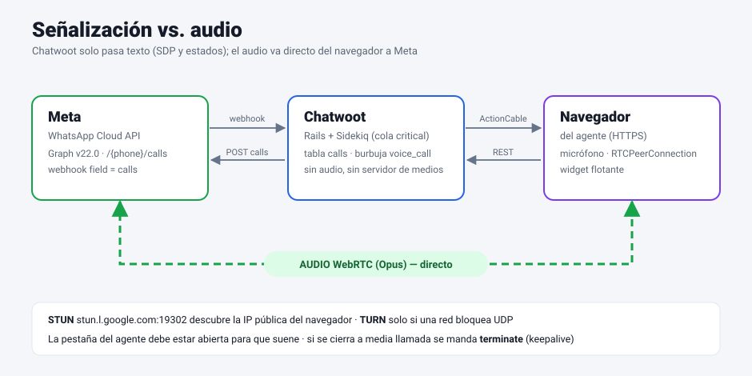
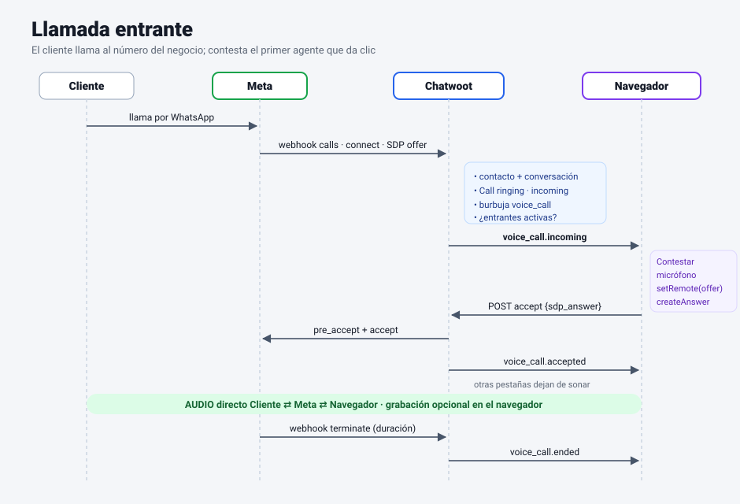
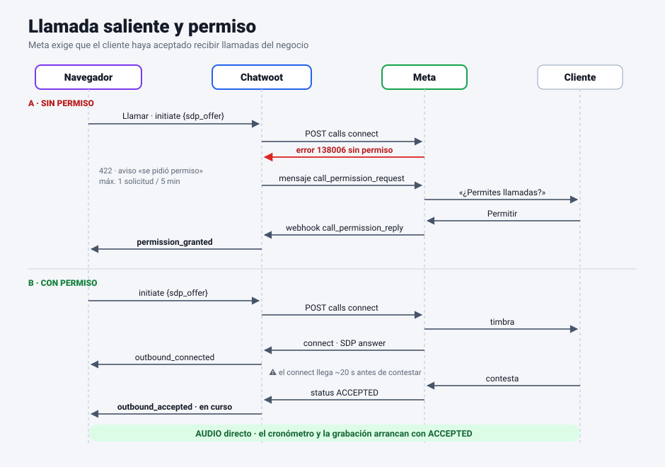
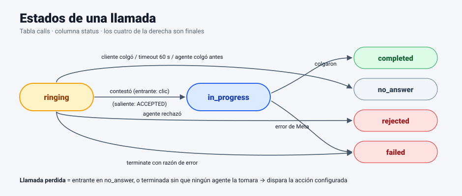
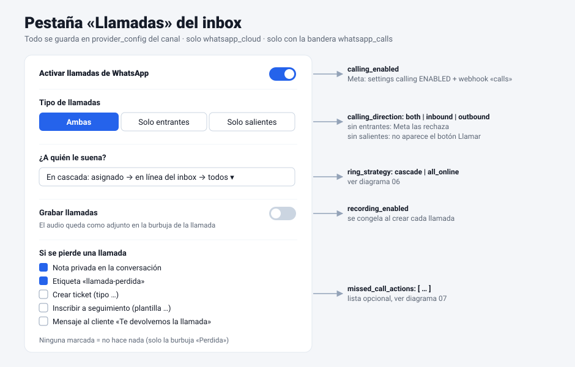
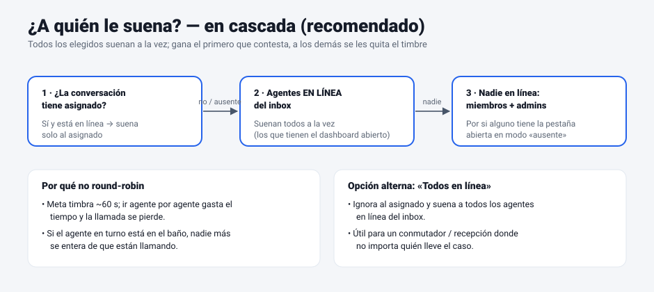
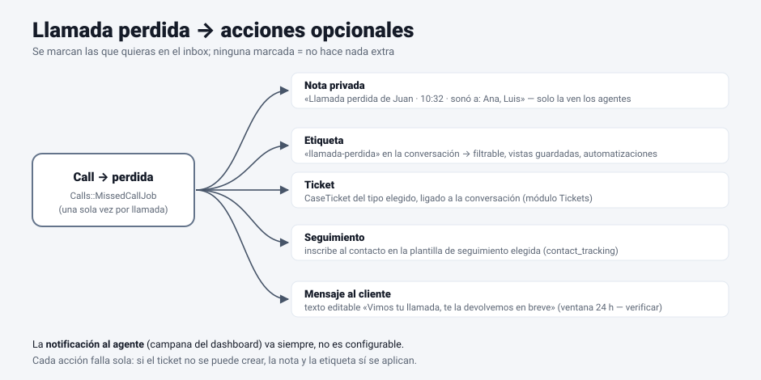
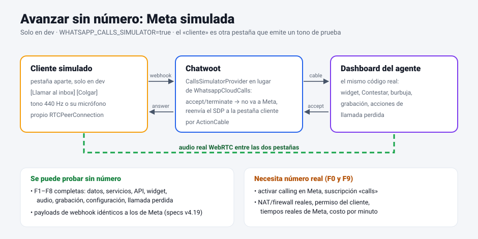
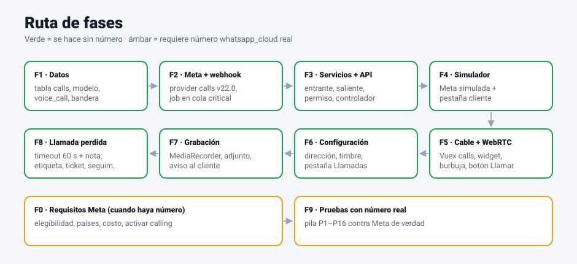

# Plan — Llamadas de WhatsApp (Cloud API) en el fork 3.13.6

**Rama:** `diag/llamadas_whatsapp` (derivada de `develop` @ `4fc45d91`)
**Base:** Chatwoot fork 3.13.6 (Rails 7.0.8, Vue 2.7 + Vuex, webpack 4)
**Referencia:** Chatwoot oficial v4.19.0 en `/opt/chatwoot_v4190` (solo lectura)
**Fecha:** 2026-10-22 · **Versión del plan:** 3 (requisitos de Meta confirmados y preguntas abiertas resueltas)
**Estado:** F1 en curso

---

## 1. Objetivo

Que un agente pueda **contestar** llamadas de voz que un cliente hace al número de
WhatsApp del negocio y **llamar** al cliente desde la conversación, todo desde el navegador,
sin teléfono ni Twilio. La llamada queda como una burbuja en la conversación (entrante o
saliente, contestada o perdida, duración, quién atendió y, si se activa, la grabación).

### Decisiones del usuario (21/10/2026)

| # | Pregunta | Decisión |
|---|---|---|
| U1 | ¿Entrantes, salientes o ambas? | **Ambas**, configurable por inbox: *Ambas / Solo entrantes / Solo salientes* |
| U2 | ¿Grabación? | **Sí, configurable** por inbox (apagada por omisión) |
| U3 | ¿A quién le suena? | Recomendación aceptada para revisión: **en cascada** (ver §4.3) con opción alterna *Todos en línea* |
| U4 | ¿Se puede avanzar sin número? | **Sí**: F1–F8 con una **Meta simulada** (§4.6); F0 y F9 esperan al número real |
| U5 | ¿Qué pasa con una llamada perdida? | **Acciones opcionales** por inbox: nada / nota privada / etiqueta / ticket / seguimiento / mensaje al cliente |

### Decisiones del 22/10/2026 (antes «Preguntas abiertas»)

| # | Pregunta | Decisión | Fase |
|---|---|---|---|
| P1 | Aviso de grabación | Mensaje automático de WhatsApp al contestar (texto configurable por bandeja, `recording_notice`) **y** guion para el agente | F7 |
| P2 | Ticket por llamada perdida | Si el contacto ya tiene un ticket **abierto del mismo tipo**, se le agrega una nota; si no, se crea uno nuevo | F8 |
| P3 | Seguimiento si ya hay uno activo | Se **omite** y queda una nota privada que lo dice (igual que las automatizaciones: un seguimiento activo por contacto y canal) | F8 |
| P4 | Quién puede llamar | **Agentes asignados a la bandeja y administradores** (los mismos que pueden contestar) | F3/F5 |

---

## 2. Cómo funciona (idea clave)

Chatwoot **no toca el audio**. Solo pasa la señalización (oferta y respuesta WebRTC = SDP,
y los estados) entre Meta y el navegador del agente. El audio va **directo** del navegador a Meta.

Consecuencias:

- **No hace falta servidor de medios** (ni Asterisk, ni Janus, ni TURN propio en el arranque).
- El navegador necesita **HTTPS + permiso de micrófono**.
- La pestaña del agente **debe estar abierta** para que suene. Si se cierra a media llamada se
  manda `terminate` con `fetch keepalive`.

### 2.1 Llamada entrante

### 2.2 Llamada saliente y permiso

Meta no deja llamar a quien no dio permiso. El primer intento devuelve el error **138006**;
Chatwoot manda entonces el mensaje interactivo `call_permission_request`. Cuando el cliente acepta
llega `call_permission_reply` y se avisa al agente.

Reglas de Meta (confirmadas 22/10/2026; la v4.19 usaba 5 min, aquí se respeta lo de Meta):
- **Máx. 1 solicitud al día y 2 por semana** por cliente y número. El servidor lleva la cuenta y,
  si ya no se puede pedir, el botón **Llamar** lo dice en vez de intentarlo.
- **Si el cliente llamó primero**, el permiso queda dado **7 días** sin pedirlo (con «Permitir que te
  llamen» activo).
- El permiso pedido dura **7 días**; luego hay que volver a pedirlo.

### 2.3 Estados

---

## 3. Brecha entre la v4.19 y el fork 3.13.6

| Pieza | v4.19 | Fork 3.13.6 | Trabajo |
|---|---|---|---|
| Tabla `calls` + modelo `Call` | `enterprise/app/models/call.rb` (Twilio + WA) | No existe | Crear, **solo WhatsApp** |
| `Message.content_type :voice_call` | `voice_call: 12` + accessor `:data` | Termina en `sticker: 11` | Agregar `12` y `:data` |
| Webhook `field=calls` | `Enterprise::Webhooks::WhatsappEventsJob` | Se procesa como mensaje y se pierde | Desviarlo en el controlador |
| Cola del webhook | `low` | `low` (**última, prioridad estricta**) | Job nuevo en `critical` |
| Suscripción a `calls` en Meta | `WebhookSetupService#subscribed_fields` | `FacebookApiClient#subscribe_webhook` sin campos | Agregar `calls` |
| Provider (Calls API) | 8 métodos, Graph **v22.0** | Provider cloud en **v14.0** | Módulo nuevo con su propia versión |
| Avisos en tiempo real | broadcast a `"account_#{id}"` | `RoomChannel` **solo** escucha `@pubsub_token` | Enviar a tokens de agentes |
| Estado en front | Pinia `stores/calls.js` | Vuex, sin Pinia | Módulo Vuex `calls` |
| WebRTC | `useWhatsappCallSession.js` | No existe | Portar (Vue 2.7 sí corre composables y `<script setup>`) |
| Widget / burbuja / ajustes | `components-next/*` (Vue 3) | No existe | Reconstruir con componentes nativos del fork |
| Grabación | `MediaRecorder` + `upload_recording` + remux OGG | No existe | Portar en F7 |
| Timeout de timbre | `Voice::RingingTimeoutService` | No existe | Job cada 30 s |
| Push VoIP móvil, Twilio, transcripción | Sí | No | **Fuera de alcance** |

Solo aplica a inboxes **`provider = 'whatsapp_cloud'`**. Los **unoapi** y **360dialog** quedan
fuera: la Calling API solo existe en Cloud API.

---

## 4. Diseño

### 4.1 Configuración por inbox (U1, U2, U3, U5)

Llaves nuevas en `channel_whatsapp.provider_config`:

| Llave | Valores | Por omisión | Efecto |
|---|---|---|---|
| `calling_enabled` | bool | `false` | Activa en Meta (`settings.calling.status = ENABLED`) y suscribe `calls` |
| `calling_direction` | `both` \| `inbound` \| `outbound` | `both` | `outbound` → las entrantes se rechazan con `reject_call`; `inbound` → no aparece **Llamar** y `initiate` responde 422 |
| `ring_strategy` | `cascade` \| `all_online` | `cascade` | Ver §4.3 |
| `recording_enabled` | bool | `false` | Se copia a `calls.meta.recording_enabled` al crear cada llamada (un cambio a media llamada no la afecta) |
| `recording_notice` | texto | vacío | Aviso opcional al cliente (ver §4.4) |
| `call_permission_request_body` | texto | i18n | Texto del mensaje que pide permiso para llamar |
| `missed_call_actions` | lista | `[]` | Ver §4.5 |

Además, bandera por cuenta **`whatsapp_calls`** en `config/features.yml` (se activa en el super
admin). Sin la bandera la pestaña no aparece y el webhook `calls` se ignora.

> Verificar en F0: si Meta permite **ocultar el botón de llamada** al cliente
> (`settings.calling.call_icon_visibility`). Con eso, *Solo salientes* se vería mejor que
> rechazar cada llamada entrante.

### 4.2 Avisos en tiempo real

El fork no tiene un stream por cuenta y no conviene agregarlo: filtraría llamadas a agentes de
otros inboxes. Un servicio nuevo `Calls::Broadcaster` decide a qué `pubsub_token` va cada evento:

| Evento | A quién |
|---|---|
| `voice_call.incoming` | Los elegidos por `ring_strategy` (§4.3) |
| `voice_call.accepted`, `voice_call.ended` | Los mismos que recibieron el `incoming` (se guardan en `calls.ring_state.ring_recipient_ids`) + el que contestó, para quitar el timbre |
| `voice_call.outbound_connected`, `outbound_accepted` | Solo el agente que llamó |
| `voice_call.permission_granted` | El agente que pidió el permiso + el asignado de la conversación |

### 4.3 ¿A quién le suena? (U3 — recomendación)

**Recomiendo la cascada** (es lo que hace la v4.19, más la regla de "solo si está en línea"):

1. Si la conversación **tiene asignado y está en línea** → suena solo al asignado.
2. Si no → suena a **todos los agentes en línea del inbox a la vez**.
3. Si no hay nadie en línea → miembros del inbox + administradores.

**Round-robin no conviene para llamadas:** Meta timbra unos 60 s. Ir agente por agente gasta
ese tiempo, y si el de turno no está, nadie más se entera. En la cascada, el round-robin del inbox
sigue funcionando igual: la conversación nueva se asigna a quien **contesta**.

Opción alterna `all_online`: ignora al asignado y suena a todos los que están en línea
(para recepción o conmutador).

### 4.4 Grabación (U2)

- Se graba **en el navegador del agente** (`MediaRecorder` mezcla micrófono + audio del cliente),
  como en la v4.19. Al colgar se sube como adjunto de audio de la burbuja (`upload_recording`).
- Entrante: graba desde que el agente contesta. Saliente: desde `ACCEPTED`, no desde `connect`
  (así no se graba el timbre).
- Si el agente cierra la pestaña a media llamada se pierde el pedazo no subido. Se acepta como
  límite conocido.
- **Aviso al cliente:** la ley mexicana de datos personales pide informar. Como el audio no pasa
  por el servidor, no se puede reproducir una locución. Opciones: (a) enviar el texto
  `recording_notice` por WhatsApp al contestar; (b) que el agente lo diga (guion). **Decisión P1:
  las dos**.

### 4.5 Llamada perdida (U5)

*Perdida* = entrante que terminó sin que ningún agente la tomara (`no_answer`, o `completed`/`failed`
sin `accepted_by_agent_id`). Al detectarla, `Calls::MissedCallJob` corre **una sola vez por llamada**
(marca `meta.missed_actions_done_at`) y aplica cada acción marcada, cada una por separado:

| Acción | Llave en `missed_call_actions` | Qué hace | Reusa |
|---|---|---|---|
| Nada | `[]` | Solo la burbuja «Perdida» y la notificación | — |
| Nota privada | `private_note` | Mensaje `private: true`: «Llamada perdida de X · hora · sonó a: …» | `Messages::MessageBuilder` |
| Etiqueta | `label` (+ nombre, por omisión `llamada-perdida`) | Agrega la etiqueta a la conversación | `conversation.add_labels` |
| Ticket | `ticket` (+ `case_type_id`) | **P2:** si hay ticket abierto del mismo tipo para el contacto, le agrega una nota; si no, crea un `CaseTicket` ligado a la conversación | Módulo Tickets (`Cases::*`, folio) |
| Seguimiento | `tracking` (+ `tracking_template_id`) | **P3:** inscribe al contacto; si ya tiene un seguimiento activo en el canal, se omite y queda nota privada | `ContactTrackings::*` (la misma lógica que la inscripción masiva) |
| Mensaje al cliente | `auto_reply` (+ texto) | «Vimos tu llamada, te la devolvemos en breve» | `SendReplyJob` normal |

- La **notificación al agente** (campana del dashboard) va siempre.
- Mensaje al cliente: verificar en F0 si una llamada entrante abre la ventana de 24 h. Si no la
  abre y no hay ventana, se omite la acción y queda una nota privada que lo explica.
- Si falla una acción, las demás siguen. El error queda en el log `[WHATSAPP CALL]`.

### 4.6 Avanzar sin número: Meta simulada (U4)

- `ENV WHATSAPP_CALLS_SIMULATOR=true`, **solo en development** (en producción se ignora).
- `Channel::Whatsapp#calls_provider` devuelve `Whatsapp::Providers::CallsSimulator` en lugar
  del provider real. Responde `true` a `pre_accept/accept/reject/terminate` y genera un `call_id`
  falso en `initiate`. En lugar de ir a Meta, reenvía el SDP a la pestaña del *cliente simulado*.
- **Cliente simulado:** una página aparte, solo en dev, con su propio `RTCPeerConnection`, que
  emite un tono de 440 Hz o el micrófono:
  - *Llamar al inbox* → crea la oferta y hace `POST /webhooks/whatsapp/:phone` con el **mismo JSON**
    que manda Meta (`field: calls`, `event: connect`, `session.sdp_type: offer`).
  - *Colgar* → webhook `terminate`.
  - Ante un `initiate` del agente contesta como si fuera Meta: `connect` con *answer* y, al dar
    clic en *Contestar*, `status: ACCEPTED`.
- Así se prueba **todo el código real** (webhook, job, servicios, cable, widget, audio,
  grabación, llamada perdida) entre dos pestañas.
- Lo que el simulador **no** cubre: elegibilidad del número, suscripción `calls`, NAT reales,
  tiempos y errores reales de Meta, costo. Eso es F0/F9.

### 4.7 Otras decisiones técnicas

| # | Decisión | Por qué |
|---|---|---|
| D1 | Código en `app/`, no en `enterprise/` | El fork no tiene licencia enterprise que lo active; `prepend_mod_with` solo complica |
| D2 | Sin Twilio: el enum `provider { twilio: 0, whatsapp: 1 }` se deja reservado | Compatibilidad si un día se trae |
| D3 | Webhook de llamadas → `Webhooks::WhatsappCallEventsJob` en cola **`critical`** | Una campaña masiva en `low` dejaría la llamada sin sonar |
| D4 | Candado Redis por `call_id` (30 s) y lápida de 60 s para `terminate` antes de `connect` | Meta no garantiza el orden (ya resuelto en v4.19) |
| D5 | Al contestar, si la conversación no tiene asignado, se asigna a quien contestó | Igual que la v4.19 |
| D6 | La burbuja `voice_call` **no** dispara Agentes IA, seguimientos ni automatizaciones de "mensaje creado" | Que el bot no responda a una llamada |
| D7 | UI con componentes nativos del fork; nada de `?.`/`??` en `<template>` | Reglas del proyecto (webpack 4) |
| D8 | Textos en español de México, con tú | Regla del proyecto |

---

## 5. Fases

Al cerrar cada fase se registra aquí qué se hizo, cómo funciona y su pila de pruebas.

### F1 — Datos *(sin número)*

- `db/migrate/<ts>_create_calls.rb`: tabla `calls` (columnas de la v4.19 + `ring_state jsonb not null default {}`),
  índices `(provider, provider_call_id) UNIQUE`, `(account_id, conversation_id)`, `(account_id, contact_id)`,
  `(account_id, created_at)`, `message_id` y el parcial `(provider, created_at) WHERE status='ringing'`.
- `app/models/call.rb`: versión recortada (estados, `missed?`, `display_status`, `default_ice_servers`).
- `Message`: `voice_call: 12` + `:data`. `has_many :calls` en `Account/Inbox/Conversation/Contact`.
- `config/features.yml`: `whatsapp_calls`. `lib/redis/redis_keys.rb`: lápida.
- Pruebas: migración sube/baja; diff de `schema.rb` solo con lo propio.

**✅ Hecho (22/10/2026)**

| Pieza | Archivo |
|---|---|
| Tabla `calls` (1 migración en lugar de 4; `provider` deja el 0 para Twilio y usa 1 = whatsapp) | `db/migrate/20261022100000_create_calls.rb` |
| Modelo recortado: estados, `missed?`, `recording_enabled?` (se decide al crear), `merge_meta!`, `default_ice_servers`, `push_event_data` | `app/models/call.rb` |
| Burbuja `voice_call: 12` + `content_attributes.data` | `app/models/message.rb` |
| `has_many :calls` | `account.rb`, `inbox.rb`, `conversation.rb`, `contact.rb` |
| Bandera `whatsapp_calls` (por cuenta, apagada) | `config/features.yml` |
| Llaves Redis: candado por llamada y lápida del terminate | `lib/redis/redis_keys.rb` |

Cómo funciona: todavía nada lo usa; es la base para F2 (webhook) y F3 (servicios). Una llamada
nace `ringing`, pasa a `in_progress` al contestar y termina en `completed`/`no_answer`/`failed`/
`rejected`. «Perdida» = entrante terminal sin agente que la tomara.

Pila de pruebas: `spec/models/call_spec.rb` (15: estados, perdida, grabación, `merge_meta!`, STUN,
datos para el dashboard, burbuja voice_call). Migración probada hacia abajo y hacia arriba (7
índices). Specs de Message/Account/Inbox/Conversation: mismas 12 fallas que sin el cambio (dependen
de datos reales de `chatwoot_dev`).

⚠️ Banderas: con `whatsapp_calls` van **62**. `feature_flags` es `bigint` con signo: cabe **una
más** (la 63); la 64 desbordaría. Antes de agregar otra, revisar.

Cómo pedírselo al Asistente: no aplica (base de datos).

### F2 — Provider de Meta y webhook *(sin número)*

- `app/services/whatsapp/providers/whatsapp_cloud_calls.rb` (módulo, Graph `v22.0`): `pre_accept_call`,
  `accept_call`, `reject_call`, `terminate_call`, `initiate_call`, `send_call_permission_request`,
  `update_calling_status`.
- `Voice::CallErrors` (`NO_CALL_PERMISSION_CODE = 138006`).
- `Webhooks::WhatsappController`: `field == 'calls'` o `interactive.type == 'call_permission_reply'`
  → `Webhooks::WhatsappCallEventsJob` (`critical`).
- `Channel::Whatsapp`: `voice_enabled?`, `inbound_calls_allowed?`, `outbound_calls_allowed?`,
  `enable_voice_calling!`, `disable_voice_calling!`, `calls_provider`.
- `FacebookApiClient#subscribe_webhook` con `subscribed_fields` (+`calls` si algún inbox del WABA lo tiene).
- Pruebas: spec del job con los payloads de los specs de v4.19.

**✅ Hecho (22/10/2026)**

| Pieza | Archivo |
|---|---|
| Calling API de Meta (v22.0): contestar (pre_accept + accept), rechazar, colgar, llamar (`NoCallPermission` con 138006), pedir permiso, activar/desactivar (oculta el botón de llamar con «solo salientes»), leer configuración | `app/services/whatsapp/providers/whatsapp_cloud_calls.rb` (incluido en `WhatsappCloudService`) |
| Errores de llamada | `app/services/voice/call_errors.rb` |
| Bandeja: `voice_enabled?` (bandera de cuenta + activada), `calling_direction` (both/inbound/outbound), `inbound/outbound_calls_allowed?`, `recording_enabled?`, `enable_voice_calling!`, `disable_voice_calling!` | `app/models/channel/whatsapp.rb` |
| Suscribir `calls` solo en bandejas de registro integrado (`calls_webhook: auto`); las configuradas a mano quedan `manual` (el admin marca `calls` en su App de Meta, F6 lo avisa) | `Channel::Whatsapp#subscribe_calls_webhook`, `FacebookApiClient#subscribe_webhook(subscribed_fields:)` |
| Webhook: el controlador manda llamadas y respuestas de permiso a un job propio en cola `critical`, con candado por llamada (reintenta si está ocupado) | `app/controllers/webhooks/whatsapp_controller.rb`, `app/jobs/webhooks/whatsapp_call_events_job.rb` |
| Búsqueda del canal del webhook, compartida con el job de mensajes | `app/jobs/concerns/whatsapp_channel_lookup.rb` |

Cómo funciona: un webhook `field=calls` (o un `call_permission_reply`) ya no cae en el job de
mensajes; va a `WhatsappCallEventsJob`, que no hace nada si la cuenta no tiene la bandera o la
bandeja no tiene llamadas activadas. Los servicios a los que despacha
(`Whatsapp::IncomingCallService`, `Whatsapp::CallPermissionReplyService`) llegan en **F3**: con la
bandera apagada (por omisión) no se llega a ellos.

Activar llamadas cambia la configuración del número **en Meta**; apagarlas lo hace primero en
Chatwoot y luego en Meta sin trabarse si Meta falla.

Pila de pruebas (27): `whatsapp_cloud_calls_spec` (11, con WebMock: cuerpos que se mandan a Meta,
138006, mensajes de error), `channel/whatsapp_calls_spec` (8: bandera, direcciones, auto/manual,
Meta rechaza → no queda activada, apagar sin trabarse), `whatsapp_call_events_job_spec` (5: cola,
reconocimiento, despacho, permiso, apagadas), controlador (+1). Specs de WhatsApp existentes: las
mismas 36 fallas que sin el cambio.

### F3 — Servicios y API *(sin número)*

- Portados quitando Twilio, push VoIP y transcripción: `Whatsapp::IncomingCallService`,
  `InboundCallIdentityBuilder` (adaptado: en el fork el `source_id` es el teléfono, sin BSUID),
  `Voice::InboundCallBuilder`, `Voice::CallMessageBuilder`, `Whatsapp::CallService`,
  `CallConversationBuilder`, `CallPermissionRequestService`, `CallPermissionReplyService`.
- `Api::V1::Accounts::WhatsappCallsController`: `show`, `accept`, `reject`, `terminate`, `initiate`.
  `initiate` respeta `calling_direction`.
- Rutas, jbuilder, i18n (`es`, `en`).
- D6: filtro de `content_type: voice_call` en el router de Agentes IA, seguimientos y automatizaciones.
- Pruebas: request specs (accept sin SDP → 422; carrera de dos agentes → 409; terminate de una
  llamada terminada → 409; initiate sin permiso → 422 `permission_requested`; initiate con
  `inbound` → 422). Ojo: RSpec corre contra `chatwoot_dev`.

### F4 — Meta simulada *(sin número)*

- `Whatsapp::Providers::CallsSimulator` + ruta y página de cliente simulado (solo dev).
- Pruebas: la pestaña simulada dispara el webhook y la llamada aparece en la conversación.

### F5 — Tiempo real, WebRTC y UI *(sin número)*

- `Calls::Broadcaster` (§4.2) + eventos en `helper/actionCable.js`.
- Vuex `store/modules/calls.js` (`incomingCall`, `activeCall`) y `api/channel/whatsapp/whatsappCallsAPI.js`.
- `composables/useWhatsappCallSession.js`: contestar, rechazar, llamar, colgar, silenciar,
  `terminate` al cerrar la pestaña.
- `components/widgets/calls/FloatingCallWidget.vue` (timbrando / en curso), montado una vez en `Dashboard.vue`, con sonido de timbre.
- `widgets/conversation/bubble/VoiceCall.vue` y botón **Llamar** en la cabecera.
- Pruebas: Chrome y Firefox; micrófono negado; dos pestañas; dos agentes.

### F6 — Configuración *(sin número; el "Activar" real se prueba en F9)*

- Endpoints en `InboxesController` (solo admin): `update_calling` (activa/desactiva en Meta y guarda llaves).
- Pestaña **Llamadas** en Configuración del inbox (§4.1). El texto del permiso es editable.
- `ring_strategy` aplicado en el `Broadcaster`; `calling_direction` aplicado en el servicio de entrantes y en `initiate`.

### F7 — Grabación *(sin número)*

- `MediaRecorder` en el composable (48 kbps Opus, remux a OGG si hay utilidad equivalente en el fork;
  si no, se sube WebM).
- `upload_recording` en el controlador, idempotente; respeta `meta.recording_enabled`.
- Reproductor en la burbuja. Aviso al cliente según la decisión pendiente.

### F8 — Timeout y llamada perdida *(sin número)*

- `Calls::RingingTimeoutJob` cada 30 s (`config/schedule.yml`): entrantes en `ringing` con más de 60 s → `no_answer`.
- `Calls::MissedCallJob` y las acciones de §4.5. Selectores de tipo de ticket y plantilla de seguimiento en la pestaña.

### F0 — Requisitos de Meta *(cuando haya número)*

- [ ] Número `whatsapp_cloud` con la Calling API disponible: **límite de mensajería ≥ 2,000 conversaciones
      iniciadas por el negocio en 24 h**, número registrado y verificado, App con webhook `calls`.
      Revisión del 22/10/2026 del único número de dev (inbox 1563, +52 1 312 140 1826, cuenta 2):
      `CLOUD_API` ✅ · calidad `GREEN` ✅ · `calling: NOT_SET` (disponible, apagado) ✅ ·
      **nombre visible `DECLINED`** ⚠️ · **verificación `EXPIRED`** ⚠️ · límite de mensajería no
      legible con el token. Pendiente del usuario: corregir nombre y verificación en WhatsApp Manager,
      o usar un **número de prueba / sandbox de Meta**.
- [ ] Países donde no se permiten llamadas iniciadas por el negocio (revisar México y los de los clientes).
- [ ] Costo por minuto de las salientes (las entrantes no se cobran; verificar tarifa vigente).
- [ ] ¿Se puede ocultar el botón de llamada al cliente? (`call_icon_visibility`)
- [ ] ¿Una llamada entrante abre la ventana de 24 h?
- [ ] Contar los inboxes `whatsapp_cloud` en producción.

### F9 — Pruebas con número real

| # | Caso | Esperado |
|---|---|---|
| P1 | Cliente llama, agente contesta | Audio en ambos sentidos; burbuja «Contestada» con duración |
| P2 | Nadie contesta | A los ~60 s «Perdida»; el widget se quita en todas las pestañas |
| P3 | Cliente cuelga mientras timbra | Widget se quita; «Perdida» |
| P4 | Dos agentes contestan a la vez | Uno conecta; al otro 409 y se le quita el widget |
| P5 | Agente rechaza | Meta corta; «Rechazada» |
| P6 | Llamar a un cliente sin permiso | Sale la solicitud de permiso; aviso al agente |
| P7 | Cliente acepta el permiso | Actividad «X permitió llamadas»; ya se puede llamar |
| P8 | Saliente con permiso | «En curso» al contestar, no en `connect` |
| P9 | Agente cierra la pestaña a media llamada | Meta termina la llamada |
| P10 | Inbox en *Solo salientes* | La entrante se rechaza; no suena nada |
| P11 | Inbox en *Solo entrantes* | No hay botón **Llamar** |
| P12 | Inbox unoapi | Ni pestaña ni botón |
| P13 | Campaña masiva en Sidekiq | La llamada suena a tiempo (`critical`) |
| P14 | Agente IA activo en el inbox | La burbuja no dispara al bot |
| P15 | Grabación activa | Audio adjunto en la burbuja, con las dos voces |
| P16 | Perdida con nota + etiqueta + ticket | Las tres se aplican una sola vez |

Estas mismas pruebas, salvo P6, P7 y P13, se corren antes contra la Meta simulada (F4–F8).

---

## 6. Riesgos

| Riesgo | Impacto | Mitigación |
|---|---|---|
| El número no es elegible a la Calling API | Bloquea la salida a producción | F0 en cuanto haya número; mientras, el simulador |
| La red del agente bloquea UDP | Conecta sin audio | `VOICE_CALL_STUN_URLS`; si pasa, TURN (coturn) como fase extra |
| Sidekiq saturado | No timbra a tiempo | Cola `critical` |
| Webhooks de Meta desordenados | Llamada fantasma | Candado por `call_id` + lápida |
| La pestaña está cerrada | Nadie oye el timbre | Notificación del navegador; acción de llamada perdida |
| Grabación sin aviso al cliente | Riesgo legal | `recording_notice` / guion (decisión pendiente) |
| El simulador difiere de Meta real | Falla en F9 | Payloads copiados de los specs de v4.19 |
| `schema.rb` arrastra otras ramas | PR sucio | Revisar el diff tras `db:migrate` |

---

## 7. Preguntas abiertas

Resueltas el 22/10/2026: ver «Decisiones del 22/10/2026» en la sección 1 (P1–P4).

---

## 8. Mapa de archivos v4.19 → fork

| v4.19 (`/opt/chatwoot_v4190`) | Fork | Cómo |
|---|---|---|
| `enterprise/app/models/call.rb` | `app/models/call.rb` | Recortar |
| `db/migrate/20260408170902_create_calls.rb` + 3 | 1 migración | Juntar |
| `enterprise/app/jobs/enterprise/webhooks/whatsapp_events_job.rb` | `app/jobs/webhooks/whatsapp_call_events_job.rb` | Job aparte, `critical` |
| `enterprise/.../providers/whatsapp_cloud_service.rb` | `app/services/whatsapp/providers/whatsapp_cloud_calls.rb` | Copiar |
| — | `app/services/whatsapp/providers/calls_simulator.rb` | **Nuevo** |
| `enterprise/app/services/whatsapp/incoming_call_service.rb` | `app/services/whatsapp/` | Broadcaster + `calling_direction` |
| `enterprise/app/services/whatsapp/call_service.rb` | `app/services/whatsapp/` | Broadcaster |
| `enterprise/app/services/whatsapp/call_permission_*_service.rb` | `app/services/whatsapp/` | Copiar |
| `enterprise/app/services/whatsapp/inbound_call_identity_builder.rb` | `app/services/whatsapp/` | Adaptar (sin BSUID) |
| `enterprise/app/services/whatsapp/call_conversation_builder.rb` | `app/services/whatsapp/` | Copiar |
| `enterprise/app/services/voice/inbound_call_builder.rb` | `app/services/voice/` | Sin push VoIP |
| `enterprise/app/services/voice/call_message_builder.rb` | `app/services/voice/` | Copiar |
| `enterprise/app/services/voice/ringing_timeout_service.rb` | `app/services/calls/` | Sin `ring_recipient_ids` como condición |
| — | `app/services/calls/broadcaster.rb`, `app/jobs/calls/missed_call_job.rb` | **Nuevos** |
| `enterprise/app/controllers/api/v1/accounts/whatsapp_calls_controller.rb` | `app/controllers/api/v1/accounts/` | Con `upload_recording` en F7 |
| `app/models/channel/whatsapp.rb` (métodos voice) | mismo archivo | Copiar + dirección |
| `dashboard/composables/useWhatsappCallSession.js` | mismo path | Portar |
| `dashboard/stores/calls.js` (Pinia) | `store/modules/calls.js` (Vuex) | Reescribir |
| `components-next/call/*`, `message/bubbles/VoiceCall.vue` | `components/widgets/calls/`, `bubble/VoiceCall.vue` | Reconstruir |
| `settings/inbox/settingsPage/WhatsappCallingPage.vue` | pestaña Llamadas del inbox | Reconstruir + acciones de perdida |

Tamaño estimado: backend ~1,400 líneas (incluye simulador y acciones de llamada perdida),
frontend ~1,200 líneas.
